<div align="center">

<picture>
  <source media="(prefers-color-scheme: dark)" srcset="docs/readme/banner-oscuro.svg">
  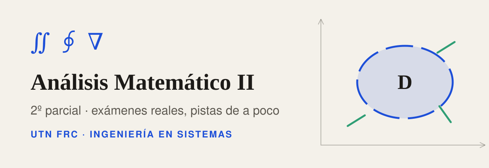
</picture>

**Practicá el 2º parcial de Análisis Matemático II (UTN FRC) con los exámenes reales: pistas de a poco, resolución verificada y modo examen con nota.**

[](https://gabibertero.github.io/AM2/)


[](https://claude.com/claude-code)

[Parciales](https://gabibertero.github.io/AM2/parciales/) · [Anteriores](https://gabibertero.github.io/AM2/anteriores/) · [Teoría](https://gabibertero.github.io/AM2/teoria/) · [Preguntero](https://gabibertero.github.io/AM2/preguntero/) · [Machetes](https://gabibertero.github.io/AM2/machetes/) · [Laboratorio](https://gabibertero.github.io/AM2/laboratorio/)

</div>

<br>

<picture>
  <source media="(prefers-color-scheme: dark)" srcset="docs/readme/mockup-oscuro.png">
  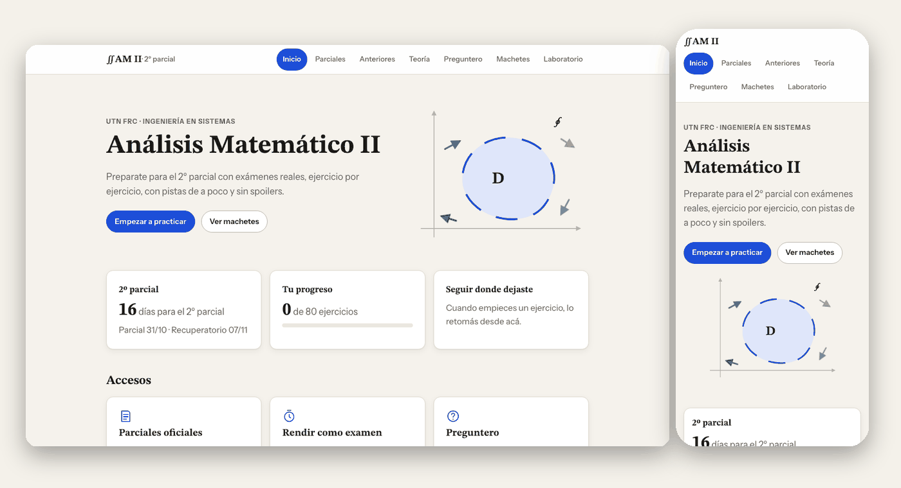
</picture>

> [!NOTE]
> Es material de estudio **no oficial**. Los enunciados y las resoluciones manuscritas son de la cátedra; las pistas, pasos, comprobaciones, criterios y la teoría están elaborados para el sitio y pueden tener errores. Contrastá siempre con tu cátedra.

<details>
<summary><b>📑 Contenido</b></summary>

- [Qué tiene](#qué-tiene)
- [Cómo usarlo](#cómo-usarlo)
- [Temas](#temas)
- [Privacidad](#privacidad)
- [Cómo está hecho](#cómo-está-hecho)
- [Para desarrollar](#para-desarrollar)
- [Roadmap](#roadmap)
- [FAQ](#faq)
- [Hecho con Claude](#hecho-con-claude)
- [Créditos y licencia](#créditos-y-licencia)

</details>

## Qué tiene

<table>
<tr>
<td valign="top" width="33%">📝 <b>11 parciales oficiales</b><br><sub>pistas, pasos, comprobación, criterio estimado y resolución oficial escaneada</sub></td>
<td valign="top" width="33%">🗂️ <b>8 años anteriores</b><br><sub>resueltos y verificados</sub></td>
<td valign="top" width="33%">⏱️ <b>Modo examen</b><br><sub>cronómetro, solo enunciados y autocalificación</sub></td>
</tr>
<tr>
<td valign="top" width="33%">🤖 <b>Corrección con IA</b><br><sub>Claude, ChatGPT o Gemini con el prompt armado</sub></td>
<td valign="top" width="33%">❓ <b>Preguntero U4–U10</b><br><sub>84 preguntas, simulacro 2 temas + 4 cortas + 3 choice</sub></td>
<td valign="top" width="33%">📖 <b>Teoría U4–U10</b><br><sub>con figuras, estilo de cátedra</sub></td>
</tr>
<tr>
<td valign="top" width="33%">🧰 <b>12 machetes</b><br><sub>qué hacer según el tipo de problema</sub></td>
<td valign="top" width="33%">🧪 <b>Laboratorio</b><br><sub>7 generadores con semilla</sub></td>
<td valign="top" width="33%">🏠 <b>Home</b><br><sub>cuenta regresiva al 2º parcial (31/10), progreso y "seguir donde dejaste"</sub></td>
</tr>
</table>

<details>
<summary><b>⏱️ Modo examen</b> (GIF)</summary>

<br>

Empezás, resolvés en papel con el reloj corriendo, entregás y te autocalificás ejercicio por ejercicio con el criterio Bien / A medias / Mal. La nota se guarda en tu navegador.

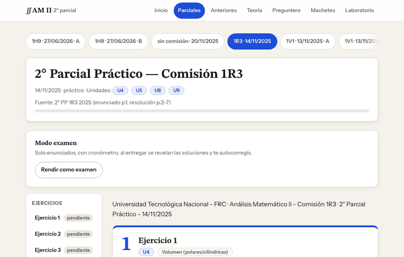

</details>

<details>
<summary><b>🧪 Laboratorio</b> (GIF)</summary>

<br>

Ejercicios nuevos de EDO de 1º y 2º orden, exactas, Bernoulli, Green y polares. La misma semilla da siempre el mismo ejercicio, así que podés pasarle el enlace a un amigo. Cada uno trae solución paso a paso.

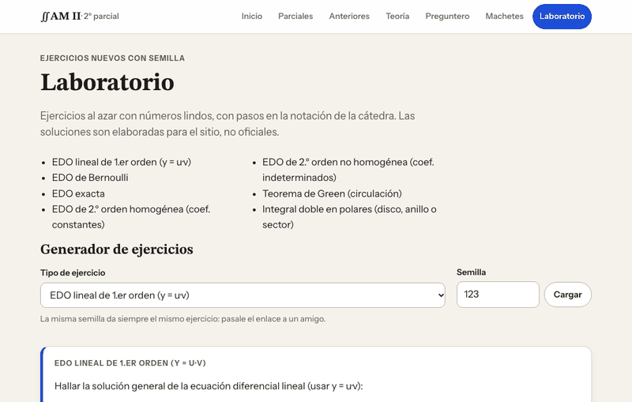

</details>

<details>
<summary><b>📝 Un parcial resuelto</b></summary>

<br>

<picture>
  <source media="(prefers-color-scheme: dark)" srcset="docs/readme/parcial-oscuro.png">
  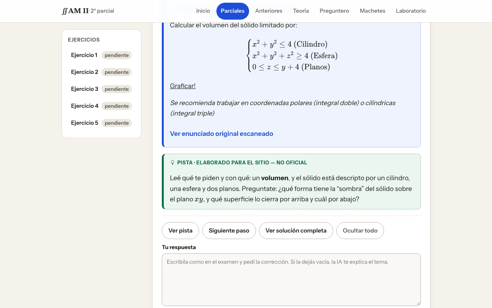
</picture>

</details>

<details>
<summary><b>❓ Preguntero</b></summary>

<br>

<picture>
  <source media="(prefers-color-scheme: dark)" srcset="docs/readme/preguntero-oscuro.png">
  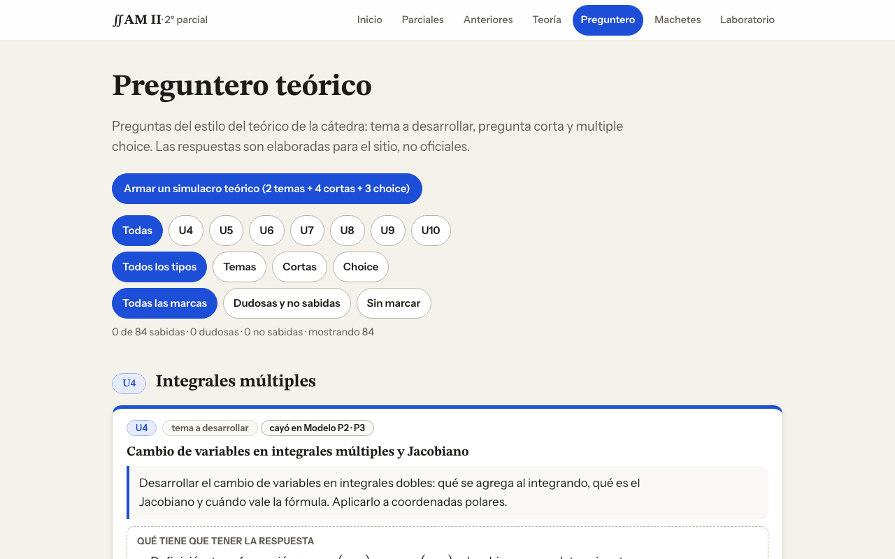
</picture>

</details>

<details>
<summary><b>📖 Teoría</b></summary>

<br>

<picture>
  <source media="(prefers-color-scheme: dark)" srcset="docs/readme/teoria-oscuro.png">
  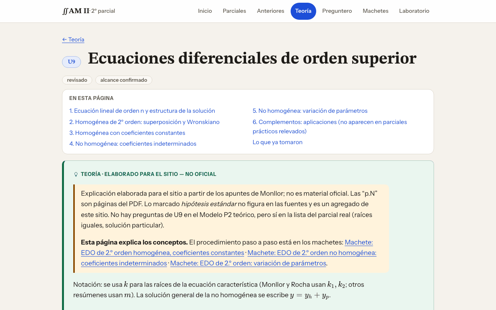
</picture>

</details>

<details>
<summary><b>📱 En el celular</b></summary>

<br>

<p align="center">
  <picture>
    <source media="(prefers-color-scheme: dark)" srcset="docs/readme/parcial-cel-oscuro.png">
    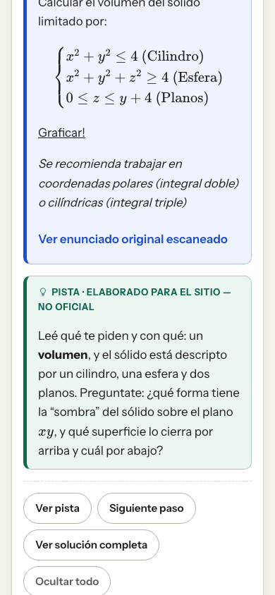
  </picture>
  <picture>
    <source media="(prefers-color-scheme: dark)" srcset="docs/readme/preguntero-cel-oscuro.png">
    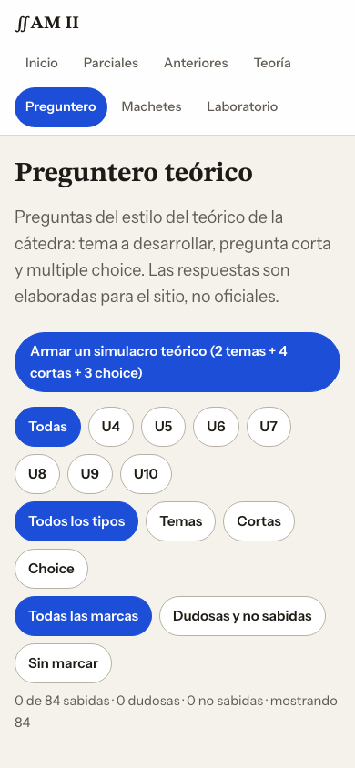
  </picture>
  <picture>
    <source media="(prefers-color-scheme: dark)" srcset="docs/readme/home-cel-oscuro.png">
    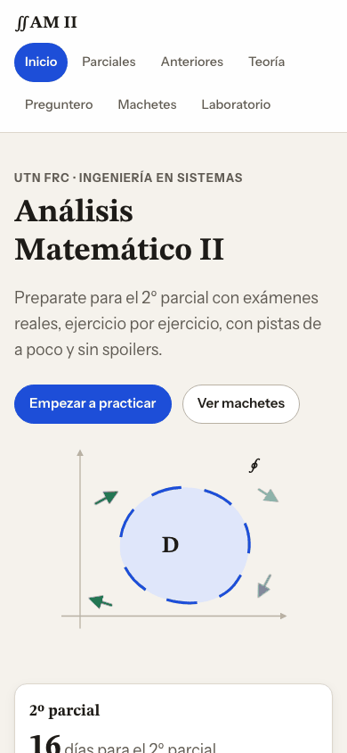
  </picture>
</p>

Diseñado para 390 px sin scroll horizontal, con tema claro y oscuro.

</details>

## Cómo usarlo

```text
1. Machete        → identificá el tipo de problema y su método
2. Teoría         → repasá la unidad si algo no cierra
3. Parcial        → resolvelo en papel, sin ayudas
4. Pista → Pasos  → pedí UNA pista, después destapá los pasos de a uno
5. Comprobación   → verificá tu resultado y marcá el estado del ejercicio
6. Modo examen    → la semana previa, un parcial entero con reloj
7. Preguntero     → simulacro de teoría (2 temas + 4 cortas + 3 choice)
```

> [!TIP]
> Si no sabés cómo arrancar, andá al **Laboratorio**: generás ejercicios con semilla hasta que el método te salga solo.

> [!NOTE]
> Tu progreso se guarda **solo en tu navegador** (`localStorage`). Si cambiás de dispositivo o borrás los datos del sitio, empezás de cero.

## Temas

| Unidad | Tema | Práctica | Teoría |
|:---:|---|:---:|:---:|
| **U4** | Integrales múltiples | ✅ | ✅ |
| **U5** | Integrales curvilíneas, Green, potencial | ✅ | ✅ |
| **U6** | Funciones vectoriales | alcance tentativo | ✅ |
| **U7** | Computación numérica | sin material | sin material |
| **U8** | EDO de 1º orden | ✅ | ✅ |
| **U9** | EDO de orden superior | ✅ | ✅ |
| **U10** | EDP | alcance tentativo | ✅ |

Fourier (U11) queda fuera. Programa 2025.

## Privacidad

- Los escaneos de la cátedra se publican **con los datos personales tapados**.
- No hay cuentas, servidor ni analítica: el progreso y las notas del modo examen viven en `localStorage` con el prefijo `am2:v1:`.
- La corrección con IA **no envía nada sola**: arma un prompt que copiás o abrís en la herramienta que elijas.

## Cómo está hecho


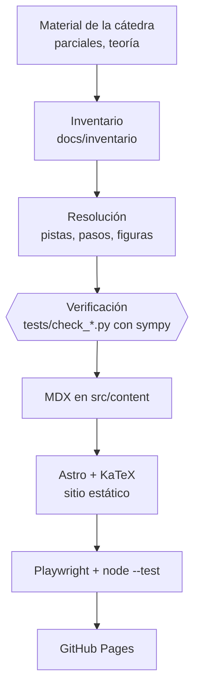

Sin framework de frontend: JavaScript vanilla, las fórmulas se renderizan al construir y el sitio funciona sin JS para leer el contenido.

<details>
<summary><b>🌳 Árbol de carpetas</b></summary>

```text
.
├── src/
│   ├── content/      parciales, anteriores, teoria, machetes, preguntas (MDX/MD)
│   ├── pages/        rutas de Astro
│   ├── components/   piezas reutilizables (ejercicio, pregunta, panel de examen)
│   ├── scripts/      examen, preguntero, progreso, IA y laboratorio (lab/)
│   └── styles/
├── tests/            *.spec.mjs (Playwright) · *.test.mjs (node --test) · check_*.py (sympy)
├── scripts/          chequeo de ids, escaneos y capturas
├── docs/             inventario, estándar de soluciones, capturas y recursos del README
├── figuras/          gráficos generados con matplotlib
├── public/           favicon y escaneos con datos tapados
└── .github/          deploy a Pages y plantillas de issues
```

</details>

## Para desarrollar

**Requisitos:** Node ≥ 22.12 (el deploy usa 24). Para los chequeos de sympy: Python 3 con `sympy`.

```bash
npm install
npm run dev            # http://localhost:4321/AM2/
npm run build          # chequea ids y construye
npm run preview        # sirve el build

npx playwright install chromium   # una sola vez
npm test               # 38 tests E2E (celular, sin JS, modo examen, laboratorio...)
npm run test:unit      # 41 tests de lógica pura
python3 tests/check_1r3.py        # un check con sympy (hay uno por examen resuelto)
```

<details>
<summary><b>➕ Cómo agregar un examen</b></summary>

1. Copiá un archivo de `src/content/parciales/` (o `anteriores/`) y completá el frontmatter: fecha, tipo, unidades y fuente.
2. Transcribí el enunciado tal cual y agregá el escaneo (con los datos personales tapados) a `public/`.
3. Escribí pistas, pasos, solución y criterio; cada ejercicio con un `id` único (`npm run check` lo valida).
4. Sumá `tests/check_<id>.py` que recalcule el resultado con sympy.
5. `npm run build && npm test`.

</details>

## Roadmap

- [x] Parciales oficiales resueltos y verificados con sympy (11)
- [x] Exámenes de años anteriores resueltos (8)
- [x] Modo examen con cronómetro y autocalificación
- [x] Corrección con IA (Claude, ChatGPT, Gemini)
- [x] Preguntero U4–U10 y simulacro 2 + 4 + 3
- [x] Teoría U4–U10 con figuras
- [x] Laboratorio con 7 generadores con semilla
- [x] Home con cuenta regresiva, progreso y "seguir donde dejaste"
- [ ] Material de U7 (computación numérica), hoy sin fuentes
- [ ] Revisar las lecturas de gráficos marcadas como pendientes en algunos años anteriores
- [ ] Más generadores en el laboratorio (integrales triples, Stokes)

## FAQ

<details>
<summary><b>¿Es oficial?</b></summary>

No. Es un proyecto de estudio hecho por estudiantes. Los enunciados y las resoluciones escaneadas son de la cátedra; el resto está elaborado para el sitio.

</details>

<details>
<summary><b>¿Se guarda mi progreso?</b></summary>

Sí, pero solo en tu navegador. No hay cuentas ni servidor, así que no se sincroniza entre dispositivos.

</details>

<details>
<summary><b>¿Qué hago si encuentro un error en un ejercicio?</b></summary>

Abrí un [issue](https://github.com/gabibertero/AM2/issues/new/choose) con el formulario "Error en un ejercicio" indicando el examen y el ejercicio. Ver [CONTRIBUTING.md](CONTRIBUTING.md).

</details>

<details>
<summary><b>¿Por qué a veces mi resultado difiere del de la resolución oficial?</b></summary>

En unos pocos casos sympy no coincide con la resolución del profe; esos casos están anotados en cada ejercicio en lugar de corregir el original.

</details>

## Hecho con Claude

Este proyecto se construyó con [Claude Code](https://claude.com/claude-code), con revisión y criterio final de Gabi. Claude hizo:

- **Diseño:** paleta, tipografía, tema claro/oscuro, favicon, Home y auditoría estética con capturas en desktop y 390 px.
- **Código:** modo examen, corrección con IA, preguntero, progreso local y laboratorio con semilla.
- **Contenido:** transcripción, resolución de los parciales y años anteriores, teoría, machetes y preguntas.
- **Verificación:** un script de sympy por examen resuelto, auditorías didácticas y code review.
- **Tests:** Playwright (E2E, celular, sin JS) y `node --test`.

Agentes que intervinieron: `resolvedor`, `web`, `disenador`, `estetica`, `profe`, `verificador`, `redactor`, `graficos`, `tester`, `readme` y `ecc:code-reviewer`. Auditorías de `profe`: parciales 91–95, preguntero 96, teoría 93.

Los commits llevan `Co-Authored-By: Claude`, por eso Claude figura en Contributors.

## Créditos y licencia

- Enunciados y resoluciones: cátedra de Análisis Matemático II, UTN FRC.
- Sitio, contenido elaborado y código: Gabi, con Claude.
- Cambios y errores: ver [CHANGELOG.md](CHANGELOG.md) y [CONTRIBUTING.md](CONTRIBUTING.md).
- Licencia: pendiente de definir. Mientras tanto, el material de la cátedra pertenece a sus autores.

<div align="center">

<br>

### Made by Claudio 🧉

<sub>Por estudiantes, para estudiantes. Hecho con [Claude Code](https://claude.com/claude-code).</sub>

</div>
