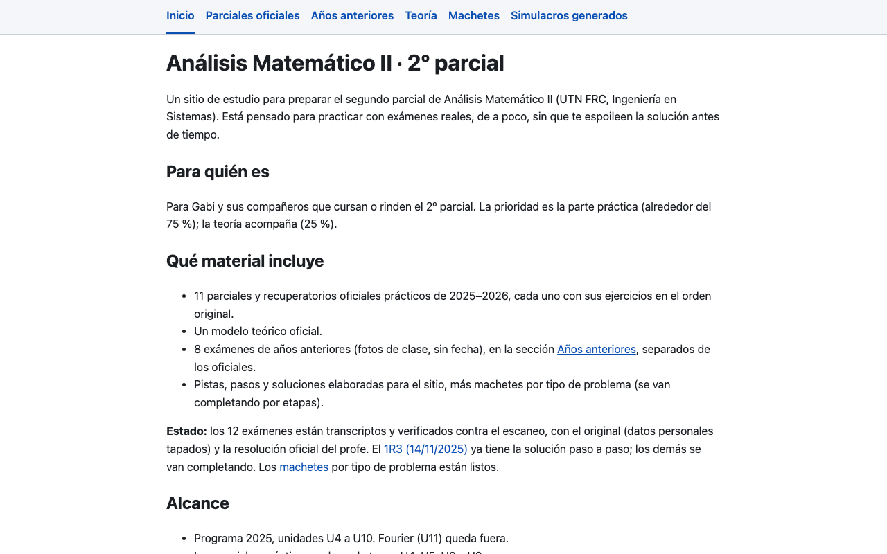
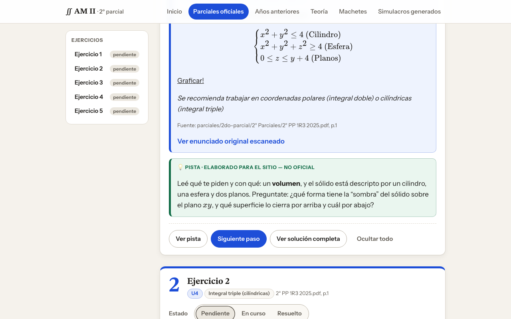
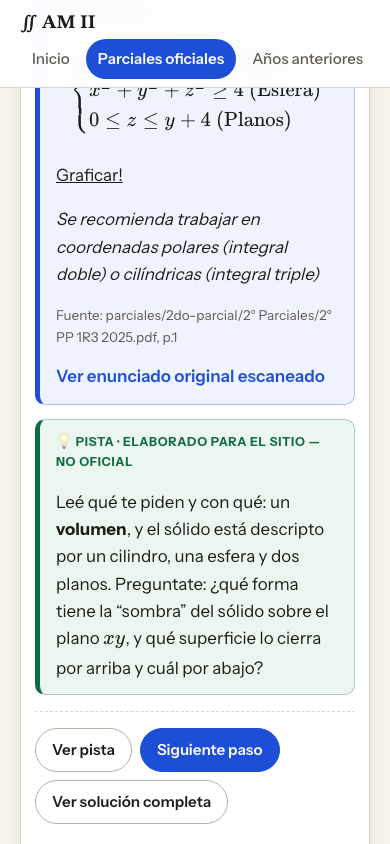
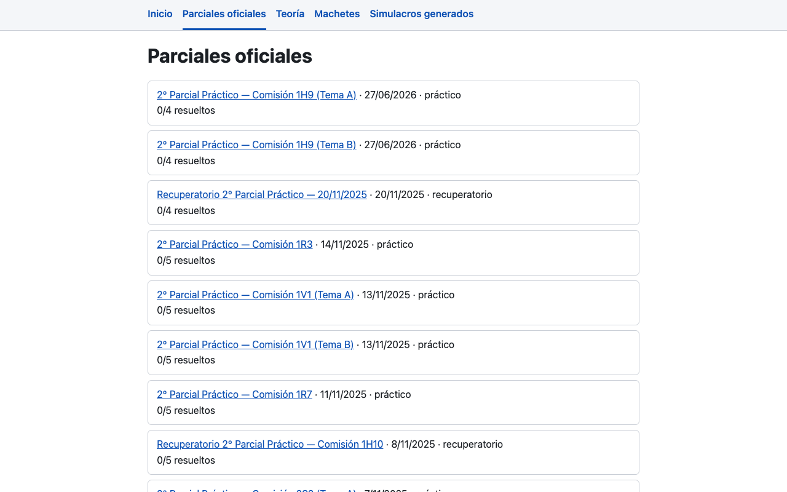
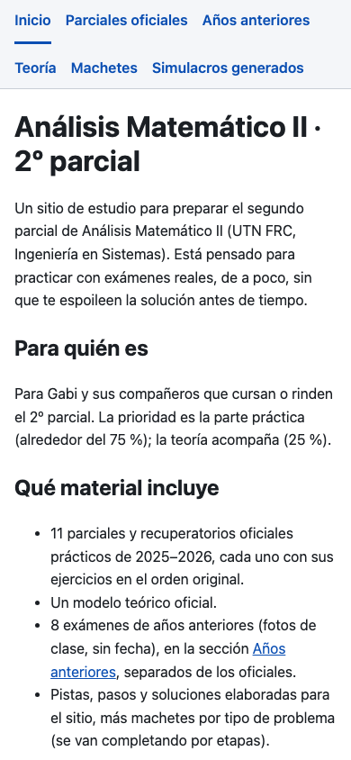

<div align="center">



# ∫ AM II · 2º parcial

### Practicá el segundo parcial de **Análisis Matemático II** (UTN FRC) con los exámenes reales, de a poco y sin spoilers.

[](https://gabibertero.github.io/AM2/)


[📝 Parciales oficiales](https://gabibertero.github.io/AM2/parciales/) &nbsp;·&nbsp; [📖 Teoría](https://gabibertero.github.io/AM2/teoria/) &nbsp;·&nbsp; [🧰 Machetes](https://gabibertero.github.io/AM2/machetes/) &nbsp;·&nbsp; [🧪 Simulacros generados](https://gabibertero.github.io/AM2/generados/)

</div>

---

## 🎯 ¿Qué es?

Un sitio estático para preparar el 2º parcial de AM II con **exámenes reales**. Cada ejercicio muestra el enunciado oficial y esconde las ayudas: primero una **pista**, después los **pasos de a uno**, al final la **solución** y su **comprobación**. Así te enterás de lo justo, cuando lo necesitás.

Además de los parciales hay machetes por tipo de problema y teoría por unidad. Todo en español, con la matemática renderizada con KaTeX.

### 👥 ¿Para quién?

Para Gabi y sus compañeros que cursan o rinden el 2º parcial. La prioridad es la **parte práctica (~75 %)**; la teoría acompaña (~25 %).

### 📐 Alcance (programa 2025)

| Unidad | Tema | Nota |
|:---:|---|---|
| **U4** | Integrales múltiples | aparece en parciales |
| **U5** | Integrales curvilíneas, Green, potencial | aparece en parciales |
| **U6** | Funciones vectoriales | tentativo, no apareció en parciales prácticos |
| **U7** | Computación numérica | sin material por ahora |
| **U8** | EDO de 1º orden | aparece en parciales |
| **U9** | EDO de orden superior | aparece en parciales |
| **U10** | EDP | tentativo, no apareció en parciales prácticos |

Fourier (U11) queda fuera.

---

## 🗺️ Secciones del sitio

| | Sección | Qué encontrás |
|:---:|---|---|
| 📝 | [**Parciales oficiales**](https://gabibertero.github.io/AM2/parciales/) | 11 parciales y recuperatorios 2025–2026 + el modelo teórico, cada uno en su pestaña y en el orden original: enunciado transcripto, escaneo original (con datos personales tapados) y resolución oficial escaneada del profe |
| 📖 | [**Teoría**](https://gabibertero.github.io/AM2/teoria/) | Resúmenes por unidad |
| 🧰 | [**Machetes**](https://gabibertero.github.io/AM2/machetes/) | Qué hacer según el tipo de problema |
| 🧪 | [**Simulacros generados**](https://gabibertero.github.io/AM2/generados/) | Exámenes armados con IA, **no oficiales**. Quedan vacíos hasta que se pidan |

En cada ejercicio marcás tu estado: **pendiente**, **en curso** o **resuelto**, y se guarda en tu navegador.

---

## 🧭 Cómo estudiar con el sitio

```
1. Machete       → mirá qué tipo de problema es y qué método usa
2. Teoría        → repasá la unidad si algo no cierra
3. Parcial       → elegí un examen y resolvelo en papel, sin mirar ayudas
4. Pista         → si te trabás, pedí UNA pista y volvé a intentar
5. Pasos         → destapá de a un paso, no la solución entera
6. Comprobación  → verificá tu resultado y marcá el ejercicio como resuelto
7. Repetí        → con los ejercicios en "en curso" o "pendiente"
```

---

## 🎨 Las tres capas

Siempre sabés qué es oficial y qué no:

| Capa | Qué es | Color |
|---|---|:---:|
| 🟦 **Oficial** | Enunciado tal cual, escaneo y resolución del profe | azul |
| 🟩 **Elaborado para el sitio** | Pistas, pasos, solución, comprobación, machetes y teoría. **No oficial** | verde |
| 🟧 **Simulacro generado** | Examen inventado. **No oficial**, solo si se pide | ámbar punteado |

---

## 📸 Capturas

<p align="center">
  
  &nbsp;
  
</p>

<p align="center">
  
  &nbsp;
  
</p>

---

## 🚧 Estado del proyecto

| Parte | Estado |
|---|:---:|
| Base y navegación | ✅ listo |
| Parciales transcriptos | 🚧 en construcción |
| Soluciones elaboradas | 🚧 en construcción |
| Machetes | 🚧 en construcción |
| Teoría | 🚧 en construcción |

Lo que todavía no está transcripto o revisado se marca como **pendiente de revisión**.

---

## 🛠️ Para quien quiera tocar el código

Stack: **Astro 7** + MDX + **KaTeX** (se renderiza al construir), JavaScript vanilla, Playwright para los tests y GitHub Pages con Actions. Requiere **Node ≥ 22.12** (probado con v26). Todos los comandos se corren desde la carpeta del proyecto (la que tiene `package.json`).

<details>
<summary><b>💻 Correr en tu compu</b></summary>

<br>

```bash
npm install
npm run dev
```

Abrí <http://localhost:4321/AM2/>. Tenés que ver la página de Inicio con el menú (Inicio · Parciales oficiales · Teoría · Machetes · Simulacros generados).

Para probar la versión construida:

```bash
npm run build
npm run preview
```

</details>

<details>
<summary><b>🧪 Tests</b></summary>

<br>

La primera vez hay que bajar el navegador de pruebas:

```bash
npx playwright install chromium
```

Después:

```bash
npm run check          # ids de ejercicio únicos y con archivo + página de origen
npm run build          # el build también falla si el chequeo de ids falla
npx playwright test    # construye, sirve el sitio y prueba el progreso
```

Resultado esperado: todo en verde, sin errores.

Para regenerar las capturas del README (después de `npm run build`): `npm run capturas`.

</details>

<details>
<summary><b>🚀 Publicar gratis en GitHub Pages</b></summary>

<br>

1. Creá en GitHub un repositorio público llamado `AM2`.
2. Subí el proyecto:
   ```bash
   git add .
   git commit -m "Sitio AM II"
   git branch -M main
   git remote add origin https://github.com/gabibertero/AM2.git
   git push -u origin main
   ```
3. En GitHub: **Settings → Pages → Source: GitHub Actions**.
4. El workflow `.github/workflows/deploy.yml` construye y publica solo. Seguilo en la pestaña **Actions**. El sitio queda en <https://gabibertero.github.io/AM2/>.

Cada `push` a `main` vuelve a publicar. Si cambiás el nombre del repo o el usuario, actualizá `site` y `base` en `astro.config.mjs`.

</details>

<details>
<summary><b>🔄 Actualizar el sitio</b></summary>

<br>

Editá o agregá archivos y después:

```bash
git add .
git commit -m "Describí el cambio"
git push
```

GitHub Pages se vuelve a publicar solo. El progreso de cada persona no se toca.

</details>

<details>
<summary><b>💾 Progreso</b></summary>

<br>

Se guarda **en el navegador de cada persona** (`localStorage`), con claves que empiezan con `am2:v1:`. No hay cuentas ni servidor, así que **no pasa de un dispositivo a otro**.

Para empezar de cero: botón **"Reiniciar progreso"** en Inicio (pide confirmación en la página y borra solo las claves `am2:v1:`), o borrar los datos del sitio desde el navegador.

</details>

<details>
<summary><b>📁 Estructura del proyecto</b></summary>

<br>

```
.
├── src/
│   ├── content/
│   │   ├── parciales/   un .mdx por examen
│   │   ├── teoria/
│   │   └── machetes/
│   ├── components/      Ejercicio, Enunciado, Pista, Paso, Solucion, Comprobacion…
│   ├── layouts/
│   ├── pages/
│   ├── scripts/         progreso (JS vanilla)
│   └── styles/
├── scripts/             check-ids.mjs, capturas.mjs
├── tests/               Playwright
├── docs/                ids.md, inventario/, capturas/
├── .github/workflows/   deploy.yml
├── SPEC.md              especificación
└── TASKS.md             tareas
```

Cada ejercicio tiene un id fijo `<comisión>-<fecha>#<n>` (ej. `1r3-2025-11-14#1`) del que depende el progreso guardado: no se cambia. La lista está en `docs/ids.md`.

</details>

<details>
<summary><b>🔒 Fidelidad y privacidad</b></summary>

<br>

- Los enunciados oficiales van **tal cual** aparecen: redacción, símbolos, numeración y orden. Lo ilegible se marca *pendiente de revisión*, nunca se reconstruye a ojo.
- Cada ejercicio indica su **fuente: archivo + página**.
- Si un recálculo no coincide con la resolución del profe, se marca; el original no se corrige.
- El repo es público: en los escaneos publicados van **tapados el nombre, la firma y el legajo**.
- Lo oficial y lo elaborado para el sitio nunca se mezclan (ver las tres capas).

</details>

---

## 🤝 Contributors

<table>
<tr>
<td align="center"><a href="https://claude.ai"><br><sub><b>Claude</b></sub></a><br><sub>alias Claudio 🤖</sub></td>
</tr>
</table>

¿Encontraste algo mal o tenés una idea? Abrí un [issue](https://github.com/gabibertero/AM2/issues) y contá en qué parcial y ejercicio está.

---

<div align="center">

⚠️ Hecho con IA a partir de material de cátedra: parciales, resoluciones del profe y apuntes.<br>
Por estudiantes, para estudiantes. Puede tener errores: usalo como **complemento** de las clases.

<br>

### Made by Claudio 🧉

</div>
