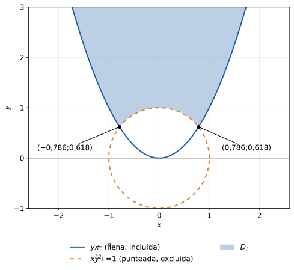
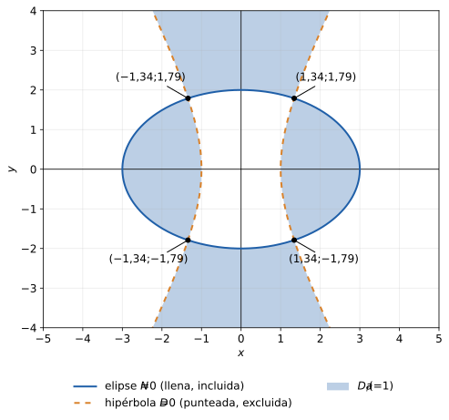

## Cómo reconocerlo
- "Determine gráfica y analíticamente el dominio de la función $z=f(x,y)$".
- Aparecen $\ln$, raíces, cocientes, a veces $\arcsin$/$\arccos$; dentro de cada uno hay una expresión con cónicas (circunferencia, elipse, hipérbola, parábola) o rectas.
- Siempre se pide el **dibujo** con el borde bien marcado (línea llena o punteada).

## Qué necesitás antes
- Restricciones de cada operación:

| Operación | Restricción |
|---|---|
| Cociente $\dfrac AB$ | $B\ne0$ |
| Raíz de índice par $\sqrt A$ | $A\ge0$ |
| Logaritmo $\ln A$ | $A>0$ |
| $\arcsin A,\ \arccos A$ | $-1\le A\le1$ |

- Identificar cónicas (completar cuadrados si hace falta): $(x-a)^2+(y-b)^2=r^2$ circunferencia; $\frac{(x-a)^2}{p^2}+\frac{(y-b)^2}{q^2}=1$ elipse; signos opuestos entre los cuadrados, hipérbola; $y=ax^2+bx+c$ parábola.
- El dominio es la **intersección** de todas las condiciones (se pide todo a la vez).

## Pasos
1. Escribir **una restricción por cada operación** (raíz, log, denominador, arco). Si una raíz está en un denominador, junta las dos: $A>0$ (estricta).
2. Si hay un **producto o cociente** que debe ser $>0$ (o $\ge0$): dos casos, **S1** (ambos factores $>0$) y **S2** (ambos $<0$). Dominio $=S_1\cup S_2$.
3. Cambiar cada desigualdad por su **igualdad** y dibujar la cónica o recta: es el borde.
4. **Borde:** línea **llena** si la desigualdad es $\ge$ o $\le$ (el borde pertenece); **punteada** si es $>$ o $<$ (no pertenece).
5. Elegir un **punto de prueba** en cada zona (no sobre el borde) y reemplazar en la desigualdad para saber qué lado sombrear.
6. Calcular los puntos de intersección entre curvas (resolver el sistema) y rotularlos.
7. Intersectar las regiones y sombrear. Escribir $D_f=\{(x,y)\in\mathbb R^2:\ \dots\}$ con todas las condiciones.

## Fórmulas clave

$$\begin{aligned}D_f=\{(x,y)\in\mathbb R^2:\ &\text{todas las restricciones}\\&\text{a la vez}\}\end{aligned}$$

$$\begin{aligned}A\cdot B>0\ \Leftrightarrow\ &(A>0\wedge B>0)\\&\vee\ (A<0\wedge B<0)\end{aligned}$$
- Borde llena: pertenece al dominio ($\ge,\le$). Borde punteada: no pertenece ($>,<$, o $\ne0$).
- Una curva puede ser borde **lleno en un tramo y punteado en otro** si viene de restricciones distintas.
- **Módulo en un logaritmo:** $\ln|A|$ pide solo $A\ne0$ (no $A>0$): se **excluye la curva** $A=0$, no una región (1H10 Sep-25 #1: $\ln|4-x^2-4y^2|$ saca la elipse $x^2+4y^2=4$). Ese ejercicio no tiene resolución oficial en el PDF; la resolución del sitio es elaborada.
- **Producto en el denominador:** $xy\ne0$ saca **los dos ejes** ($x\ne0$ e $y\ne0$), con borde punteado; hay que fijarse si alguna de las dos ya queda excluida por otra condición (Recup. Nov-25 #1: con $xy\sqrt{y^2-x^2+4}$ abajo se pide además $y^2-x^2+4>0$; y el disco $x^2+y^2\le9$ del numerador entra con borde **lleno** porque esa raíz admite $0$).

## Ejemplo resuelto
$z=\ln(x^2+y^2-1)+\sqrt{y-x^2}$ _(propio, verificado a mano)_.
- Log: $x^2+y^2-1>0$, o sea exterior de la circunferencia de radio 1, **borde punteado**.
- Raíz: $y-x^2\ge0$, o sea $y\ge x^2$, región sobre la parábola, **borde lleno**.
- Intersección de curvas: $y=x^2$ en $x^2+y^2=1$ da $y+y^2=1$, $y=\frac{-1+\sqrt5}{2}\approx0{,}618$, $x=\pm0{,}786$.
- Punto de prueba $(0,2)$: $4>1$ y $2\ge0$, cumple. El origen no cumple ($0>1$ falso).

$$D_f=\{(x,y):\ x^2+y^2>1\ \wedge\ y\ge x^2\}$$

Si en cambio fuera $\ln[(y-x)(x^2+y^2-1)]$: S1 $y>x\wedge x^2+y^2>1$, S2 $y<x\wedge x^2+y^2<1$; $D_f=S_1\cup S_2$, todo con borde punteado.

**Gráfico:**

**Raíz de un cociente $\ge0$, con parámetro $a$** (1H9 May-24 #1): $z=\sqrt{\dfrac{N}{D}}$ con $N=\frac{x^2}{9}+\frac{y^2}{4}-a^2$ y $D=a^2-x^2+\frac{y^2}{4}$. El cociente es $\ge0$ cuando los dos tienen el mismo signo (el cero del numerador se admite, el del denominador no):

$$\big(N\ge0\wedge D>0\big)\ \vee\ \big(N\le0\wedge D<0\big)$$

- $N=0$ es la **elipse** $\frac{x^2}{(3a)^2}+\frac{y^2}{(2a)^2}=1$, **borde lleno** (ahí el cociente vale $0$). $N\ge0$ es el exterior, $N\le0$ el interior.
- $D=0$ es la **hipérbola** $\frac{x^2}{a^2}-\frac{y^2}{(2a)^2}=1$, **borde punteado** (divide por cero). $D>0$ es entre las ramas (contiene al origen), $D<0$ adentro de las ramas.
- Caso 1: exterior de la elipse y entre las ramas (dos piezas no acotadas, arriba y abajo). Caso 2: interior de la elipse y adentro de las ramas (dos "lentes" a los costados). El dominio es la **unión** de los dos casos.
- El profe pide el **gráfico consolidado** con $a$, $2a$ y $3a$ marcados: los dos casos juntos en un solo dibujo, elipse llena e hipérbola punteada.
- Cortes elipse-hipérbola: $\left(\pm\frac{3a}{\sqrt5};\pm\frac{4a}{\sqrt5}\right)$.
- **Caso $a=0$ aparte** (se dividió por $a^2$): $N=\frac{x^2}{9}+\frac{y^2}{4}\ge0$, $D=\frac{y^2}{4}-x^2$ y queda $D>0$, o sea $|y|>2|x|$ (el origen da $\frac00$ y queda afuera).

## Errores frecuentes
- Dibujar siempre el borde lleno: hay que decidir **curva por curva** si pertenece.
- Olvidar que $\ln$ y el denominador piden $>0$ / $\ne0$ (borde fuera), y la raíz sola pide $\ge0$ (borde dentro).
- Raíz **en el denominador**: es $>0$, no $\ge0$.
- En un producto $>0$, tomar solo el caso en que ambos son positivos y olvidar S2 (ambos negativos).
- Sombrear sin punto de prueba: se invierte el lado.
- No completar cuadrados y confundir la cónica (hipérbola vs. elipse).
- Dar solo el dibujo o solo la fórmula: se piden **gráfica y analíticamente**.
- Raíz de un cociente: quedarse con un solo caso (faltan las piezas de $N\le0\wedge D<0$), o incluir el borde de lo que está en el denominador.
- Con parámetro: tratar $a$ como variable, o no ver el caso $a=0$.
- $\ln|A|$: exigir $A>0$ (con módulo solo se excluye $A=0$).
- Olvidar que $xy\ne0$ saca **ambos** ejes.

## Cómo comprobar el resultado
- Elegí un punto dentro de la región final y reemplazalo en la función original: tiene que dar un número real.
- Elegí uno fuera (y uno sobre cada borde) y verificá que el borde punteado **no** está y el lleno **sí**.
- Revisá que la intersección de curvas dibujada coincida con la que calculaste.

> **Elaborado para el sitio — verificar con la cátedra:** la tabla de restricciones y el método S1/S2 siguen el resumen de la cátedra (U1 p. 15-33 y fotos de método); el ejemplo del log y la raíz es propio; los de cociente con parámetro, $\ln|A|$ y $xy\ne0$ son de 1H9 May-24 #1 (resolución del profe), 1H10 Sep-25 #1 (sin resolución oficial) y Recup. Nov-25 #1. Hay seis dominios más de 2023 en los ejercicios linkeados.
