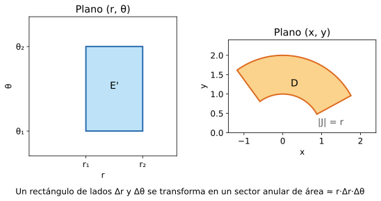
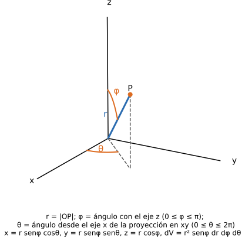

> Explicación elaborada para el sitio a partir de los apuntes de Monllor; no es material oficial. Las páginas "p.N" son páginas del PDF (no la numeración impresa). Lo marcado _hipótesis estándar_ no figura en los apuntes y es un agregado de este sitio. Cada concepto sigue el estilo de la cátedra: definición, propiedades, desarrollo y gráfico.
>
> **Esta página explica los conceptos.** Para el procedimiento paso a paso están los machetes: [Machete: Volumen entre superficies (polares / cilíndricas)](../../machetes/volumen-polares-cilindricas/) · [Machete: Integral triple en cilíndricas y esféricas](../../machetes/integral-triple-cilindricas-esfericas/).

## 1. Integral doble en un rectángulo

**Definición.** Sea $f(x,y)$ definida en $R=[a,b]\times[c,d]$. Se divide $R$ en subrectángulos $R_{ij}$ de área $\Delta A_{ij}=\Delta x_i\,\Delta y_j$, se elige un punto $(x_{ij},y_{ij})$ en cada uno y se forma la **suma doble de Riemann**. La integral doble es el límite cuando la **diagonal** del mayor subrectángulo tiende a 0 _(precisión estándar: con "área → 0" un rectángulo fino no achica el lado; Monllor habla del área del mayor subrectángulo)_:

$$\iint_R f(x,y)\,dA=\lim_{\text{diag}_{\max}\to 0}\ \sum_{j=1}^{m}\sum_{i=1}^{n} f(x_{ij},y_{ij})\,\Delta A_{ij}$$

**Condiciones (solo si…).**
- Para calcularla con **integrales iteradas** (el resultado no depende del orden) alcanza con que $f$ sea **continua** en el dominio de integración. Fuente: 05-INTEGRALES MULTIPLES 2015.pdf p.6
- Si $f\ge 0$ en $R$, la integral es el **volumen** bajo la superficie $z=f(x,y)$ sobre $R$. Si $f$ cambia de signo, el resultado ya no es un volumen.

**Fórmula (integrales iteradas).**

$$\iint_R f\,dA=\int_c^d\!\left[\int_a^b f(x,y)\,dx\right]dy=\int_a^b\!\left[\int_c^d f(x,y)\,dy\right]dx$$

Se resuelve primero la integral interior (la otra variable se trata como constante) y después la exterior.

**Propiedades.** Linealidad, aditividad respecto del dominio ($D=D_1\cup D_2$ sin superposición), monotonía (si $f_1\le f_2$ entonces $\iint f_1\le\iint f_2$) y, con $f\equiv1$, el resultado es el área de $D$ (sección 3).

**Interpretación.** Cada término de la suma es el volumen de una "columna" de base $\Delta A_{ij}$ y altura $f(x_{ij},y_{ij})$; la iterada equivale a cortar el cuerpo en rebanadas.

**Ejemplo mínimo.** $\displaystyle\iint_R (x+y)\,dA$ con $R=[0,1]\times[0,2]$: $\int_0^1\!\int_0^2 (x+y)\,dy\,dx=\int_0^1 (2x+2)\,dx=3$.

**Gráfico.** Rectángulo $R$ en el plano $xy$ dividido en una grilla; sobre un subrectángulo $R_{ij}$, una columna de altura $f(x_{ij},y_{ij})$ que llega hasta la superficie $z=f(x,y)$. Las columnas juntas aproximan el volumen bajo la superficie.

**¿Dónde se usa?** Es la base de todo lo que sigue. En los parciales prácticos aparece como plantear una integral doble sobre una región acotada por curvas (ver sección 2).

Fuente: 05-INTEGRALES MULTIPLES 2015.pdf p.3-7; 11_Integrales dobles.pdf p.1

## 2. Dominios generales y dominio regular

**Definición.** Para integrar sobre un dominio $D$ que no es un rectángulo, se lo encierra en un rectángulo $R$ y se define $g=f$ dentro de $D$ y $g=0$ fuera de $D$; entonces $\iint_D f\,dA=\iint_R g\,dA$.
Un dominio es **regular en la dirección del eje $x$** si toda recta paralela a ese eje que pasa por un punto interior corta a la frontera en solo dos puntos (idem para $y$). Si lo es en ambas direcciones se dice simplemente **regular**. Fuente: 05-INTEGRALES MULTIPLES 2015.pdf p.8-9, 12

**Condiciones.** Los límites de la integral iterada son funciones de la variable "exterior" solo si el dominio es regular en la dirección de la integral interior; si no, hay que **dividirlo** en dominios regulares y sumar (propiedad aditiva).

**Fórmula.**

$$\iint_D f\,dA=\int_{x_1}^{x_2}\!\int_{\varphi_1(x)}^{\varphi_2(x)} f(x,y)\,dy\,dx$$

o bien, integrando primero en $x$:

$$\iint_D f\,dA=\int_{y_1}^{y_2}\!\int_{\psi_1(y)}^{\psi_2(y)} f(x,y)\,dx\,dy$$

$x_1,x_2$ son constantes (extremos del dominio en $x$); $\varphi_1(x)\le y\le\varphi_2(x)$ son las curvas inferior y superior. Es **imprescindible dibujar el dominio** para elegir el orden y los límites (Monllor p.10).

**Ejemplo mínimo.** $D$ limitado por $y=x$ e $y=x^2$ (con $0\le x\le 1$):
$\iint_D (x+y)\,dA=\int_0^1\!\int_{x^2}^{x}(x+y)\,dy\,dx=\dfrac{3}{20}$. _(Verificado con sympy.)_

**Gráfico.** Región $D$ entre $x=x_1$ y $x=x_2$, con la curva inferior $y=\varphi_1(x)$ y la superior $y=\varphi_2(x)$; una recta vertical por un punto interior corta la frontera en solo dos puntos. Contraejemplo: una región en forma de "C" o de herradura es cortada en más de dos puntos por una recta y hay que dividirla en dos regulares.

**¿Dónde se usa?** En todo ejercicio que pida el volumen o el área de una región entre curvas, antes de decidir si conviene pasar a polares. [Machete: Volumen entre superficies (polares / cilíndricas)](../../machetes/volumen-polares-cilindricas/)

## 3. Propiedades de la integral doble (y triple)

**Propiedades usadas** (valen igual en triples): linealidad; **aditividad** respecto del dominio ($D=D_1\cup D_2$ sin superposición); si $f_1\le f_2$ en $D$ entonces $\iint_D f_1\le\iint_D f_2$; y si $f\equiv 1$, **la integral da el área** (doble) o el **volumen** (triple):

$$A_D=\iint_D dx\,dy \qquad\qquad V=\iiint_V dx\,dy\,dz$$

**Volumen entre dos superficies.** Si el cuerpo está limitado por $z=\psi_1(x,y)$ (abajo) y $z=\psi_2(x,y)$ (arriba), con proyección $D$ sobre el plano $xy$: $V=\iint_D[\psi_2-\psi_1]\,dx\,dy$. Fuente: 05-INTEGRALES MULTIPLES 2015.pdf p.11, 13

**Gráfico.** Cuerpo entre las superficies $z=\psi_1$ (abajo) y $z=\psi_2$ (arriba), con su sombra $D$ en el plano $xy$; el volumen es el de las columnas de base $dx\,dy$ y altura $\psi_2-\psi_1$.

**¿Dónde se usa?** El primer ejercicio de la mayoría de los parciales prácticos es un volumen: ver los ejercicios de [Machete: Volumen entre superficies (polares / cilíndricas)](../../machetes/volumen-polares-cilindricas/). Ejercicios oficiales: [`1r3-2025-11-14#1`](../../parciales/1r3-2025-11-14/), [`1r7-2025-11-11#1`](../../parciales/1r7-2025-11-11/), [`1v1-2025-11-13-a#1`](../../parciales/1v1-2025-11-13-a/), [`1v1-2025-11-13-b#1`](../../parciales/1v1-2025-11-13-b/), [`2s2-2025-11-07-a#1`](../../parciales/2s2-2025-11-07-a/), [`2s2-2025-11-07-b#1`](../../parciales/2s2-2025-11-07-b/), [`recup-1h9-2025-07-05#1`](../../parciales/recup-1h9-2025-07-05/), [`recup-1h10-2025-11-08#1`](../../parciales/recup-1h10-2025-11-08/).

## 4. Aplicaciones físicas y área de superficie

**Masa y momentos** (lámina con densidad superficial $\mu(x,y)$ en $D$; cuerpo con densidad $\mu(x,y,z)$ en $V$):

| Magnitud | Lámina (doble) | Cuerpo (triple) |
|---|---|---|
| Masa $M$ | $\iint_D \mu\,dA$ | $\iiint_V \mu\,dV$ |
| Momento estático resp. al eje $x$ / plano $xz$ | $M_x=\iint_D y\,\mu\,dA$ | $M_{xz}=\iiint_V y\,\mu\,dV$ |
| Centro de gravedad | $x_c=M_y/M,\ y_c=M_x/M$ | $x_c=M_{yz}/M$ (y análogos) |
| Momento de inercia resp. al eje $x$ | $I_x=\iint_D y^2\mu\,dA$ | $I_x=\iiint_V (y^2+z^2)\mu\,dV$ |

Si $\mu\equiv 1$ se obtiene el centro geométrico. Fuente: 05-INTEGRALES MULTIPLES 2015.pdf p.14, 31-32

**Área de una superficie** $z=f(x,y)$ sobre $D$ (solo si $f$ es continua y tiene derivadas parciales continuas):

$$A_S=\iint_D\sqrt{1+\left(\frac{\partial z}{\partial x}\right)^2+\left(\frac{\partial z}{\partial y}\right)^2}\;dx\,dy$$

Ejemplo mínimo: el plano $z=x+y$ sobre $[0,1]\times[0,1]$ tiene área $\sqrt3$ _(verificado con sympy)_. Fuente: 05-INTEGRALES MULTIPLES 2015.pdf p.15-17

**Gráfico.** Superficie $z=f(x,y)$ sobre $D$; un elemento $dx\,dy$ del plano $xy$ se corresponde con un trozo de plano tangente de área $\sqrt{1+z_x^2+z_y^2}\,dx\,dy$ (mayor cuanto más inclinada la superficie).

**¿Dónde se usa?** No aparece en los parciales prácticos relevados; sí en las guías (Monllor, Rocha). Sirve para entender qué mide cada integral.

## 5. Cambio de variables y Jacobiano

**Definición.** Si $x=g_1(u,v)$, $y=g_2(u,v)$ transforman un dominio $E$ del plano $uv$ en $D$ del plano $xy$, el **Jacobiano** de la transformación es el determinante

$$J\!\left(\frac{x,y}{u,v}\right)=\begin{vmatrix}\dfrac{\partial x}{\partial u}&\dfrac{\partial y}{\partial u}\\[2mm]\dfrac{\partial x}{\partial v}&\dfrac{\partial y}{\partial v}\end{vmatrix}=\frac{\partial x}{\partial u}\frac{\partial y}{\partial v}-\frac{\partial x}{\partial v}\frac{\partial y}{\partial u}$$

**Condiciones (solo si…).** $g_1,g_2$ son **continuas con derivadas parciales de primer orden continuas**, y a cada punto $(x,y)$ le corresponde **un solo** $(u,v)$ y viceversa (correspondencia biunívoca). El Jacobiano se toma **en valor absoluto**. Además se espera $J\neq 0$ en el interior (puede anularse en puntos aislados o en la frontera, como $r=0$ en polares) _(hipótesis estándar; Monllor no la nombra)_. Fuente: 05-INTEGRALES MULTIPLES 2015.pdf p.23, 25

**Fórmula.**

$$\iint_D f(x,y)\,dx\,dy=\iint_E f\big[g_1(u,v),g_2(u,v)\big]\;\Big|J\Big(\frac{x,y}{u,v}\Big)\Big|\;du\,dv$$

$f[g_1,g_2]$ es $f$ reescrita en $(u,v)$; $|J|$ es el factor de escala de áreas.

**Caso de tres variables** (extensión directa; es lo que usan cilíndricas y esféricas). Si $x=g_1(u,v,w),\ y=g_2(u,v,w),\ z=g_3(u,v,w)$:

$$J\!\left(\frac{x,y,z}{u,v,w}\right)=\begin{vmatrix}\dfrac{\partial x}{\partial u}&\dfrac{\partial y}{\partial u}&\dfrac{\partial z}{\partial u}\\[2mm]\dfrac{\partial x}{\partial v}&\dfrac{\partial y}{\partial v}&\dfrac{\partial z}{\partial v}\\[2mm]\dfrac{\partial x}{\partial w}&\dfrac{\partial y}{\partial w}&\dfrac{\partial z}{\partial w}\end{vmatrix},\qquad \iiint_V f\,dx\,dy\,dz=\iiint_{V'} f[g_1,g_2,g_3]\,\Big|J\Big|\,du\,dv\,dw$$

**Interpretación geométrica.** Un rectángulo $\Delta u\times\Delta v$ se transforma aproximadamente en un paralelogramo de lados $\vec T_u\,\Delta u$ y $\vec T_v\,\Delta v$; su área es $|\vec T_u\times\vec T_v|\,\Delta u\,\Delta v=|J|\,\Delta u\,\Delta v$. Idea de la demostración (Monllor p.24-25): aproximar la imagen de cada rectángulo por ese paralelogramo y pasar al límite.

**Ejemplo mínimo.** $x=u+v,\ y=u-v$: $J=\begin{vmatrix}1&1\\1&-1\end{vmatrix}=-2$, entonces $|J|=2$ y $dx\,dy=2\,du\,dv$ _(verificado con sympy)_.

**Gráfico.** Dos planos lado a lado: a la izquierda $E$ en $(u,v)$ con un rectángulo chico $\Delta u\times\Delta v$; a la derecha $D$ en $(x,y)$ con su imagen, un paralelogramo curvo de lados $\vec T_u\Delta u$ y $\vec T_v\Delta v$. La razón entre las áreas es $|J|$.

La figura muestra el caso polar: un rectángulo del plano $(r,\theta)$ se transforma en un sector anular.

**¿Dónde se usa?** Es el fundamento de polares, cilíndricas y esféricas. Pregunta teórica oficial: [Modelo P2 teórico, pregunta 3](../../parciales/modelo-teorico/) ("¿qué factor se agrega al integrando?": el **Jacobiano en valor absoluto**).

## 6. Coordenadas polares (doble)

**Definición.** $x=r\cos\theta,\ y=r\sin\theta$, con $r\ge0,\ 0\le\theta\le2\pi$ (o el intervalo que corresponda). Es un caso particular de cambio de variables con

$$J\!\left(\frac{x,y}{r,\theta}\right)=\begin{vmatrix}\cos\theta&\sin\theta\\-r\sin\theta&r\cos\theta\end{vmatrix}=r\cos^2\theta+r\sin^2\theta=r,$$

así que $|J|=r$ (en la región $r\ge0$) _(verificado con sympy)_.

**Condiciones.** Conviene cuando el dominio es un círculo, un sector o un anillo, o cuando aparece $x^2+y^2$ en la función o en los límites. Hay que **reescribir también el dominio**: $x^2+y^2=a^2\Rightarrow r=a$. Fuente: 05-INTEGRALES MULTIPLES 2015.pdf p.19-22, 26

**Fórmula.**

$$\iint_D f(x,y)\,dx\,dy=\iint_{D'} f(r\cos\theta,\,r\sin\theta)\;r\,dr\,d\theta$$

El factor $r$ **no se puede olvidar**: es el Jacobiano.

**Interpretación.** El "rectángulo polar" $\Delta r\times\Delta\theta$ es un sector anular de área $r\,\Delta r\,\Delta\theta$ aproximadamente.

**Ejemplo mínimo.** $\iint_D (x^2+y^2)\,dA$ con $D:\ x^2+y^2\le a^2$: $\int_0^{2\pi}\!\int_0^a r^2\,r\,dr\,d\theta=\dfrac{\pi a^4}{2}$ _(verificado con sympy)_.

**Gráfico.** Plano $xy$ con un punto $P$, su distancia $r$ al origen y el ángulo $\theta$ desde el eje $x$ (antihorario). Un "rectángulo polar" $\Delta r\times\Delta\theta$ es un sector anular de lados $\Delta r$ y $r\,\Delta\theta$. Al lado, el dominio $D'$ en el plano $(r,\theta)$: un círculo de radio $a$ se vuelve el rectángulo $[0,a]\times[0,2\pi]$.

**¿Dónde se usa?** [Machete: Volumen entre superficies (polares / cilíndricas)](../../machetes/volumen-polares-cilindricas/). Ejercicios oficiales: [`1r3-2025-11-14#1`](../../parciales/1r3-2025-11-14/), [`1r7-2025-11-11#1`](../../parciales/1r7-2025-11-11/), [`1v1-2025-11-13-a#1`](../../parciales/1v1-2025-11-13-a/), [`1v1-2025-11-13-b#1`](../../parciales/1v1-2025-11-13-b/), [`2s2-2025-11-07-a#1`](../../parciales/2s2-2025-11-07-a/), [`2s2-2025-11-07-b#1`](../../parciales/2s2-2025-11-07-b/), [`recup-1h9-2025-07-05#1`](../../parciales/recup-1h9-2025-07-05/), [`recup-1h10-2025-11-08#1`](../../parciales/recup-1h10-2025-11-08/). Práctica con resultados: Rocha-Giordano Fuente: 11_Integrales dobles_CC.pdf p.1.

## 7. Integral triple

**Definición.** Es la extensión a tres variables: suma triple de Riemann sobre subparalelepípedos de volumen $\Delta V_{ijk}=\Delta x_i\Delta y_j\Delta z_k$ y límite cuando el mayor tiende a 0.

$$\iiint_E f\,dV=\iiint_E f(x,y,z)\,dx\,dy\,dz$$

**Fórmula iterada.** Si $E$ está entre $z=\psi_1(x,y)$ y $z=\psi_2(x,y)$ con proyección $D$ en el plano $xy$ _(forma estándar; es la de la sección 3 con integrando $f$)_:

$$\iiint_E f\,dV=\iint_D\left[\int_{\psi_1(x,y)}^{\psi_2(x,y)} f(x,y,z)\,dz\right]dx\,dy$$

y la doble sobre $D$ se plantea como en la sección 2.

**Condiciones.** Igual que en la doble: $f$ continua para poder usar integrales iteradas; el orden depende de la conveniencia y **la última integral debe tener límites constantes** (Rocha 12, p.1). Hay que **graficar el cuerpo** para plantear los límites. Si $f$ es una densidad, la integral da la **masa**; si $f\equiv1$, el **volumen**. Fuente: 05-INTEGRALES MULTIPLES 2015.pdf p.27-28; 12_Integrales triples.pdf p.1

**Propiedades.** Valen las de la doble: linealidad, aditividad respecto del cuerpo y monotonía.

**Ejemplo mínimo.** Volumen del cuerpo entre $z=x^2+y^2$ y $z=4$: se proyecta en $D:\ x^2+y^2\le4$; en cartesianas es incómodo, en cilíndricas es directo (sección 8).

**Gráfico.** El cuerpo $E$ en ejes $x,y,z$, su proyección sobre el plano $xy$ y las superficies que lo limitan por abajo y por arriba; los límites de la última integral salen de los extremos de esa proyección.

**¿Dónde se usa?** Ver cilíndricas y esféricas.

## 8. Coordenadas cilíndricas

**Definición.** $x=r\cos\theta,\ y=r\sin\theta,\ z=z$. Son polares en el plano $xy$ más la altura. $|J|=r$ _(verificado con sympy)_.

**Condiciones.** Conviene cuando el cuerpo tiene **simetría respecto de un eje** (cilindros, paraboloides $z=x^2+y^2$, conos $z=\sqrt{x^2+y^2}$). Hay que transformar también las superficies que lo limitan: $x^2+y^2=a^2\to r=a$; $z=x^2+y^2\to z=r^2$. Fuente: 05-INTEGRALES MULTIPLES 2015.pdf p.35-36; 12_Integrales triples_CC.pdf p.1

**Fórmula.**

$$\iiint_V f(x,y,z)\,dx\,dy\,dz=\iiint_{V'} g(r,\theta,z)\;r\,dr\,d\theta\,dz$$

**Ejemplo mínimo.** Volumen entre $z=x^2+y^2$ y $z=4$: $\displaystyle\int_0^{2\pi}\!\int_0^2\!\int_{r^2}^4 r\,dz\,dr\,d\theta=8\pi$ _(verificado con sympy)_.

**Gráfico.** Ejes $x,y,z$; un punto $P$ con su proyección $P'$ en el plano $xy$. $r=|OP'|$, $\theta$ es el ángulo de $OP'$ desde el eje $x$ y $z$ la altura de $P$ sobre el plano. Paraboloide $z=r^2$ cortado por el plano $z=4$.

**¿Dónde se usa?** [Machete: Integral triple en cilíndricas y esféricas](../../machetes/integral-triple-cilindricas-esfericas/). Ejercicios oficiales: [`1r3-2025-11-14#2`](../../parciales/1r3-2025-11-14/), [`1r7-2025-11-11#2`](../../parciales/1r7-2025-11-11/), [`1v1-2025-11-13-a#2`](../../parciales/1v1-2025-11-13-a/), [`1v1-2025-11-13-b#2`](../../parciales/1v1-2025-11-13-b/), [`2s2-2025-11-07-a#2`](../../parciales/2s2-2025-11-07-a/), [`2s2-2025-11-07-b#2`](../../parciales/2s2-2025-11-07-b/), [`recup-1h10-2025-11-08#2`](../../parciales/recup-1h10-2025-11-08/), [`1h9-2026-06-27-a#1`](../../parciales/1h9-2026-06-27-a/), [`1h9-2026-06-27-b#1`](../../parciales/1h9-2026-06-27-b/), [`recup-2025-11-20#1`](../../parciales/recup-2025-11-20/).

## 9. Coordenadas esféricas

**Definición (notación de la cátedra, Monllor y Rocha).** $r$ = distancia al origen, $\theta$ = ángulo en el plano $xy$ desde el eje $x$, $\varphi$ = ángulo desde el eje $z$:

$$x=r\sin\varphi\cos\theta,\qquad y=r\sin\varphi\sin\theta,\qquad z=r\cos\varphi,\qquad 0\le\theta\le2\pi,\ 0\le\varphi\le\pi$$

**Condiciones.** Conviene con **simetría respecto de un punto** (esferas, conos con vértice en el origen, $x^2+y^2+z^2$ en la función). Como $0\le\varphi\le\pi$, $\sin\varphi\ge0$: el Jacobiano es $r^2\sin\varphi$ **en valor absoluto** (el determinante en el orden $(r,\theta,\varphi)$ da $-r^2\sin\varphi$) _(verificado con sympy)_. Desarrollando por la tercera columna:

$$J=\begin{vmatrix}\sin\varphi\cos\theta&\sin\varphi\sin\theta&\cos\varphi\\-r\sin\varphi\sin\theta&r\sin\varphi\cos\theta&0\\r\cos\varphi\cos\theta&r\cos\varphi\sin\theta&-r\sin\varphi\end{vmatrix}=\cos\varphi\,(-r^2\sin\varphi\cos\varphi)-r\sin\varphi\,(r\sin^2\varphi)=-r^2\sin\varphi$$

Fuente: 05-INTEGRALES MULTIPLES 2015.pdf p.37-38; 12_Integrales triples_CC.pdf p.1

**Fórmula.**

$$\iiint_V f\,dx\,dy\,dz=\iiint_{V'} g(r,\theta,\varphi)\;r^2\sin\varphi\;dr\,d\theta\,d\varphi$$

**Ejemplo mínimo.** Volumen de una esfera de radio $R$: $\int_0^{2\pi}\!\int_0^{\pi}\!\int_0^R r^2\sin\varphi\,dr\,d\varphi\,d\theta=\dfrac{4}{3}\pi R^3$ _(verificado con sympy)_.

**Gráfico.** Ejes $x,y,z$; un punto $P$ con $r=|OP|$, el ángulo $\varphi$ entre $OP$ y el eje $z$, y $\theta$ el ángulo desde el eje $x$ de la proyección de $OP$ en el plano $xy$. Un elemento esférico es un "cubito" de lados $dr$, $r\,d\varphi$ y $r\sin\varphi\,d\theta$, de donde sale el volumen $r^2\sin\varphi\,dr\,d\varphi\,d\theta$.

**Nota de fuentes.** En Rocha 12_CC p.1 la fórmula de $z$ está escrita con $\cos(\theta)$ en lugar de $\cos(\varphi)$ [sic]; acá se usa la versión de Monllor.

**¿Dónde se usa?** [Machete: Integral triple en cilíndricas y esféricas](../../machetes/integral-triple-cilindricas-esfericas/). Ejercicios oficiales: [`1r3-2025-11-14#2`](../../parciales/1r3-2025-11-14/), [`1r7-2025-11-11#2`](../../parciales/1r7-2025-11-11/), [`1v1-2025-11-13-a#2`](../../parciales/1v1-2025-11-13-a/), [`1v1-2025-11-13-b#2`](../../parciales/1v1-2025-11-13-b/), [`2s2-2025-11-07-a#2`](../../parciales/2s2-2025-11-07-a/), [`2s2-2025-11-07-b#2`](../../parciales/2s2-2025-11-07-b/), [`recup-1h10-2025-11-08#2`](../../parciales/recup-1h10-2025-11-08/), [`1h9-2026-06-27-a#1`](../../parciales/1h9-2026-06-27-a/), [`1h9-2026-06-27-b#1`](../../parciales/1h9-2026-06-27-b/), [`recup-2025-11-20#1`](../../parciales/recup-2025-11-20/).

## Lo que ya tomaron

Fuentes: `../Links e Info.md` (apuntes de un compañero sobre el 2º parcial teórico) y [Modelo P2 teórico](../../parciales/modelo-teorico/) (oficial).

- **Parcial unificado, pregunta 3** (todos los temas iguales): _en un cambio de variables, además de redefinir la función, ¿qué factor hay que agregar al integrando?_ → el **Jacobiano de la transformación, en valor absoluto** (en polares y cilíndricas $r$; en esféricas $r^2\sin\varphi$). Es la pregunta 3 del [Modelo P2 teórico](../../parciales/modelo-teorico/) (su respuesta oficial está en el link).
- Formato del 2º teórico: 2 temas (elegir uno y desarrollar), 4 preguntas cortas, 3 de opción múltiple. Para U4, como tema, lo natural es el cambio de variables con el Jacobiano (secciones 5 y 6).
- Cómo estudiarla: definición del Jacobiano, condiciones (continuidad, derivadas continuas, biyección, $|J|$), la fórmula, la idea del paralelogramo y el caso polares.

**Preguntero de la unidad:** [preguntas de U4 (temas, cortas y choice)](../../preguntero/#h-U4).
