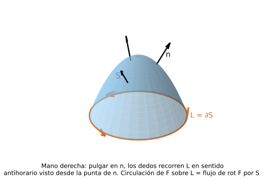
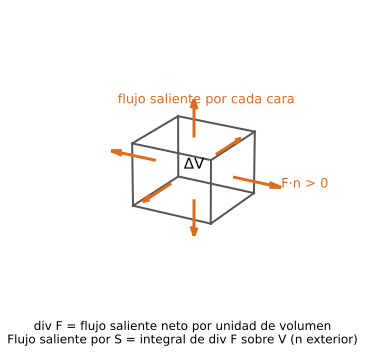

> **Alcance tentativo.** No apareció en ningún parcial práctico oficial relevado; la única fuente completa es Monllor 07. Sí aparece en el Modelo P2 teórico (preguntas 4, 5 y 6) y en el 2º teórico real (rotor). Explicación elaborada para el sitio; no es material oficial. Las "p.N" son páginas del PDF. Lo marcado _hipótesis estándar_ no figura en las fuentes y es un agregado de este sitio.
>
> No hay machetes para esta unidad: esta página explica los conceptos y trae un ejemplo mínimo de cada tema.

Notación de la cátedra: $\vec F=P(x,y,z)\,\vec i+Q(x,y,z)\,\vec j+R(x,y,z)\,\vec k$; $\vec n=\cos\alpha\,\vec i+\cos\beta\,\vec j+\cos\gamma\,\vec k$ es el versor normal; $d\sigma$ el elemento de superficie; $\operatorname{rot}\vec F=\nabla\times\vec F$ (por determinante), $\operatorname{div}\vec F=\nabla\cdot\vec F$.

## 1. Función vectorial y campo vectorial (dominio)

**Definición.** Una **función vectorial** $\vec r:\mathbb R\to\mathbb R^m$ asigna a un número real $t$ (parámetro) un vector: $\vec r(t)=[f(t),g(t),h(t)]$. Describe curvas y movimientos. Un **campo vectorial** $\vec F:\mathbb R^n\to\mathbb R^m$ asigna a cada punto un vector: en $\mathbb R^2$, $\vec F(x,y)=P\,\vec i+Q\,\vec j$; en $\mathbb R^3$, $\vec F(x,y,z)=P\,\vec i+Q\,\vec j+R\,\vec k$. Equivale a $m$ campos escalares (las componentes). Fuente: 04 - FUNCIONES VECTORIALES 2015.pdf p.2-3, 7-8

**Dominio.** Para una función vectorial, el dominio es el conjunto de valores de $t$ donde está definida, y es la **intersección de los dominios de las funciones componentes** (Monllor 04 p.3). Para un campo, el mismo criterio sobre las componentes: el dominio es la intersección de los dominios de $P,Q,R$ _(el mismo criterio aplicado a campos; Monllor lo enuncia para funciones vectoriales)_.

**Condiciones al calcularlo.** Exigir que cada componente esté definida: denominadores $\ne0$, argumentos de raíz $\ge0$ (índice par), argumentos de $\ln$ $>0$, etc.

**Ejemplo mínimo.** $\vec F(x,y)=\left[\dfrac{1}{x-y},\ \sqrt{y}\right]$: la primera componente exige $x\ne y$ y la segunda $y\ge0$; el dominio es $\{(x,y):\ x\ne y,\ y\ge0\}$. En $\mathbb R^3$: $\vec G(x,y,z)=\left[\dfrac1{x-y},\ \sqrt z,\ \ln(x+y)\right]$ tiene dominio $\{x\ne y,\ z\ge0,\ x+y>0\}$.

**Gráfico.** Para el ejemplo plano: el semiplano $y\ge0$ con la recta $y=x$ (la parte que cae en $y\ge0$) dibujada punteada y excluida del dominio.

**Pregunta oficial:** [Modelo P2 teórico, pregunta 6](../../parciales/modelo-teorico/) (la respuesta oficial del modelo define campo vectorial $\vec f:\mathbb R^n\to\mathbb R^m$, $\vec f=[P,Q]$ y se corta ahí; el criterio de la intersección sale de Monllor 04 p.3).

## 2. Derivada de un campo vectorial (matriz Jacobiana)

**Definición.** Un campo con $m$ componentes de $n$ variables tiene $m\times n$ derivadas parciales, que se ordenan en la **matriz Jacobiana**; las filas son los gradientes de las componentes:

$$D\vec F=\begin{bmatrix}\dfrac{\partial f_1}{\partial x_1}&\cdots&\dfrac{\partial f_1}{\partial x_n}\\ \vdots&&\vdots\\ \dfrac{\partial f_m}{\partial x_1}&\cdots&\dfrac{\partial f_m}{\partial x_n}\end{bmatrix}=\begin{bmatrix}\nabla f_1\\ \vdots\\ \nabla f_m\end{bmatrix}$$

**Casos particulares.** Campo escalar ($m=1$): la Jacobiana es una fila, el **gradiente**. Función vectorial de una variable ($n=1$): una columna, y $\vec r\,'(t)=[f',g',h']$, que es **tangente** a la curva si existe y no es nulo. Si $m=n$ la matriz es cuadrada y su determinante es el **Jacobiano** (el mismo de los cambios de variables, U4). Fuente: 04 - FUNCIONES VECTORIALES 2015.pdf p.6, 9-10; Modelo P2 teorico.pdf p.3

**Propiedades.** Evaluada en un punto $P_0$ es una matriz de números, $D\vec F(P_0)$. El campo es **diferenciable** en el punto si cada componente lo es; una condición suficiente es que las derivadas parciales sean continuas _(hipótesis estándar)_.

**Ejemplo mínimo.** $\vec F=(x^2y,\ yz,\ xz^2)$: $D\vec F=\begin{bmatrix}2xy&x^2&0\\0&z&y\\z^2&0&2xz\end{bmatrix}$.

**Gráfico.** Para $n=1$, la curva $\vec r(t)$ con el vector $\vec r\,'(t)$ dibujado tangente a ella en un punto. Para $m=1$, las curvas de nivel de un campo escalar con el gradiente (fila de la Jacobiana) perpendicular a ellas.

**Pregunta oficial:** [Modelo P2 teórico, pregunta 4](../../parciales/modelo-teorico/).

## 3. Operador nabla y gradiente

**Definición.** El **operador de Hamilton (nabla)** es un vector simbólico $\nabla=\dfrac{\partial}{\partial x}\vec i+\dfrac{\partial}{\partial y}\vec j+\dfrac{\partial}{\partial z}\vec k$: no es una cantidad, indica derivaciones que se aplican a lo que sigue. Aplicado a un campo escalar $u$ da el **gradiente**: $\operatorname{grad}u=\nabla u=\left(\dfrac{\partial u}{\partial x},\dfrac{\partial u}{\partial y},\dfrac{\partial u}{\partial z}\right)$.

**Interpretación.** En cada punto, $\nabla u$ es normal a la superficie de nivel $u=C$ y apunta en la dirección de **máximo crecimiento**; su módulo $|\nabla u|$ es el valor máximo de la derivada direccional. Fuente: 07-INTEGRALES DE SUPERFICIE 2015.pdf p.2-3

**Gráfico.** Curvas de nivel $u=C$ en el plano y, en un punto, el vector $\nabla u$ perpendicular a la curva que pasa por ahí y apuntando hacia donde $u$ crece.

## 4. Divergencia

**Definición (concepto, en un punto).** La divergencia en $P_0$ es el flujo saliente por unidad de volumen, en el límite cuando el volumen $V$ que encierra a $P_0$ tiende a cero _(hipótesis estándar; Monllor la define por la fórmula en coordenadas y la interpretación física)_:

$$\operatorname{div}\vec F(P_0)=\lim_{V\to P_0}\frac1V\iint_{S}\vec F\cdot\vec n\,d\sigma$$

con $S$ el borde de $V$ y $\vec n$ la normal exterior (sale del Teorema de la Divergencia, sección 8). Es un campo **escalar**, que en coordenadas se calcula así:

$$\operatorname{div}\vec F=\nabla\cdot\vec F=\frac{\partial P}{\partial x}+\frac{\partial Q}{\partial y}+\frac{\partial R}{\partial z}$$

Equivale a la **traza de la matriz Jacobiana** (solo para campos $\mathbb R^n\to\mathbb R^n$) (oficial, [Modelo P2 teórico, pregunta 5](../../parciales/modelo-teorico/)).

**Condiciones.** $P,Q,R$ con derivadas parciales de primer orden; para las propiedades de más abajo, de segundo orden continuas.

**Interpretación (oficial y Monllor).** Si $\vec F$ es la velocidad de un fluido, la divergencia en un punto mide cuánto fluido **se introduce o se extrae** por unidad de volumen: $\nabla\cdot\vec F>0$ es una **fuente** (la densidad en el punto disminuye), $<0$ un **sumidero** (aumenta), $=0$ el fluido se mueve sin acumularse (incompresible si la densidad es constante). Fuente: 07-INTEGRALES DE SUPERFICIE 2015.pdf p.4; Modelo P2 teorico.pdf p.3-4

**Ejemplo mínimo.** $\vec F=(x^2y,\ yz,\ xz^2)$: $\operatorname{div}\vec F=2xy+z+2xz$ _(verificado con sympy)_.

**Gráfico.** Dos esquemas en el plano: flechas que salen radialmente desde un punto (por ejemplo $\vec F=(x,y)$, $\operatorname{div}>0$, fuente) y flechas que entran hacia un punto ($\vec F=(-x,-y)$, $\operatorname{div}<0$, sumidero).

**Pregunta oficial:** [Modelo P2 teórico, pregunta 5](../../parciales/modelo-teorico/) ("escriba el concepto de divergencia de un campo vectorial en un punto e indique qué representa").

## 5. Rotor, campo irrotacional y solenoidal, Laplaciano

**Rotor (definición).** Es un campo **vectorial**, calculado por determinante:

$$\operatorname{rot}\vec F=\nabla\times\vec F=\begin{vmatrix}\vec i&\vec j&\vec k\\ \dfrac{\partial}{\partial x}&\dfrac{\partial}{\partial y}&\dfrac{\partial}{\partial z}\\ P&Q&R\end{vmatrix}=\Big(\frac{\partial R}{\partial y}-\frac{\partial Q}{\partial z}\Big)\vec i+\Big(\frac{\partial P}{\partial z}-\frac{\partial R}{\partial x}\Big)\vec j+\Big(\frac{\partial Q}{\partial x}-\frac{\partial P}{\partial y}\Big)\vec k$$

**Interpretación.** Mide el **giro local** del campo: si $\vec v$ es la velocidad de un fluido y $\vec\omega$ la velocidad angular con que gira una pequeña esfera del fluido, entonces

$$\operatorname{rot}\vec v=2\,\vec\omega$$

El rotor es el **doble** de la velocidad angular y su dirección es el eje de giro. ⚠️ Monllor (07, p.5) dice que el rotor "da la medida de la velocidad angular"; la relación exacta es $2\omega$ (para $\vec v=\vec\omega\times\vec r$ con $\vec\omega=(0,0,w)$: $\vec v=(-wy,\,wx,\,0)$ y $\operatorname{rot}\vec v=(0,0,2w)$).

Ejemplo mínimo: $\vec F=(x^2y,\,yz,\,xz^2)$ tiene $\operatorname{rot}\vec F=(-y,\,-z^2,\,-x^2)$ _(verificado con sympy)_.

**Gráfico.** Campo $\vec F=(-y,x,0)$ en el plano $xy$: flechas tangentes a circunferencias centradas en el origen, en sentido antihorario; una rueda chica colocada en el campo giraría.

**Campo irrotacional.** $\operatorname{rot}\vec F=\vec0$: equivale a $R_y=Q_z,\ P_z=R_x,\ Q_x=P_y$. **Todo campo conservativo ($\vec F=\nabla u$) es irrotacional**, porque $\operatorname{rot}(\nabla u)=\vec0$ por la igualdad de derivadas mixtas (con $u$ de derivadas segundas continuas; _estándar: Teorema de Schwarz, Monllor lo usa sin nombrarlo_).

**Campo solenoidal.** $\operatorname{div}\vec F=0$. Ocurre cuando $\vec F=\operatorname{rot}\vec A$ para algún $\vec A$, porque $\operatorname{div}(\operatorname{rot}\vec A)=0$ (la recíproca vale en dominios estrellados _(hipótesis estándar)_).

**Laplaciano y función armónica.** $\operatorname{div}(\nabla u)=\nabla^2u=\Delta u=\dfrac{\partial^2u}{\partial x^2}+\dfrac{\partial^2u}{\partial y^2}+\dfrac{\partial^2u}{\partial z^2}$. Si $\Delta u=0$ es la **ecuación de Laplace** y $u$ es una **función armónica** (por ejemplo $u=x^2-y^2$) _(verificado con sympy)_. Fuente: 07-INTEGRALES DE SUPERFICIE 2015.pdf p.5-8

## 6. Integral de superficie y flujo

**Definición.** Sea $S$ una superficie orientada con versor normal $\vec n(M)$ y $\vec F$ un campo definido sobre ella. La **integral de superficie** (flujo de $\vec F$ a través de $S$) es el límite de $\sum\vec F(M_i)\cdot\vec n(M_i)\,\Delta\sigma_i$:

$$\Phi=\iint_S \vec F\cdot\vec n\,d\sigma=\iint_S (P\cos\alpha+Q\cos\beta+R\cos\gamma)\,d\sigma$$

**Condiciones (solo si…).**
- La superficie debe estar **orientada** (se elige el versor normal de modo que varíe continuamente) y **antes de calcular** hay que establecer cuál es la cara positiva: en una superficie cerrada, la normal **exterior**. Una cinta de Möbius no es orientable. Cambiar la orientación cambia el signo del flujo.
- Para reducirla a una doble sobre $D$ (proyección en $xy$): $S$ dada por $z=f(x,y)$, tal que **toda paralela al eje $z$ la corta en un solo punto** (si no, se subdivide), con $\cos\gamma>0$ (normal "hacia arriba").
- Si $S$ está dada como $x=g(y,z)$ o $y=h(x,z)$, se proyecta sobre $yz$ o $xz$ respectivamente.

**Fórmula (proyección sobre $xy$).** Como $d\sigma=\dfrac{dx\,dy}{\cos\gamma}$:

$$\iint_S \vec F\cdot\vec n\,d\sigma=\iint_D\Big(-P\,\frac{\partial z}{\partial x}-Q\,\frac{\partial z}{\partial y}+R\Big)\,dx\,dy$$

con $P,Q,R$ evaluados en $(x,y,f(x,y))$.

**Interpretación.** Si $\vec F$ es la velocidad de un líquido, $\vec F\cdot\vec n\,\Delta\sigma$ es el volumen que atraviesa $\Delta\sigma$ por unidad de tiempo; $\Phi$ es el caudal total a través de $S$ en el sentido de $\vec n$.

**Ejemplo mínimo.** $\vec F=(x,y,z)$ a través del plano $x+y+z=1$ en el primer octante, normal hacia arriba: $z=1-x-y$, $z_x=z_y=-1$, el integrando es $x+y+z=1$ y $\Phi=\operatorname{Área}(D)=\tfrac12$ _(verificado con sympy)_. Fuente: 07-INTEGRALES DE SUPERFICIE 2015.pdf p.9-12

## 7. Teorema de Stokes

**Enunciado.** Sea $S$ una superficie **orientada, suave a trozos**, limitada por la curva **simple cerrada, suave a trozos** $L$ y $\vec F$ un campo con **derivadas parciales continuas en una región abierta que contiene a $S$**. Entonces

$$\iint_S \operatorname{rot}\vec F\cdot\vec n\,d\sigma=\oint_L \vec F\cdot d\vec s=\oint_L P\,dx+Q\,dy+R\,dz$$

**Orientaciones (solo si…).** La normal $\vec n$ y el sentido de $L$ deben ser **compatibles**: con $\vec n$ formando un ángulo agudo con el eje $z$, el recorrido de $L$ es tal que un observador que mira desde la punta de $\vec n$ lo ve en sentido **antihorario**. Si se invierte uno, se invierte el signo.

**Interpretación.** La circulación del campo a lo largo del borde es igual al flujo del rotor a través de cualquier superficie que se apoye en ese borde. Es la versión en el espacio del **Teorema de Green**: si $S$ es un plano paralelo a $xy$ se obtiene Green como caso particular (U5). Si $\operatorname{rot}\vec F=\vec0$ en una región **simplemente conexa**, la circulación sobre toda curva cerrada es 0 y la integral curvilínea no depende de la trayectoria; sin simple conexión no vale (U5).

**Demostración** (Monllor p.13-15). Para $S:\ z=f(x,y)$ se escribe la integral de superficie como doble sobre la proyección $D$ y la curvilínea sobre la proyección $L'$ de $L$ en el plano $xy$. Término $P$, con $\vec n\,d\sigma=(-f_x,-f_y,1)\,dx\,dy$: $\operatorname{rot}(P\vec i)=(0,P_z,-P_y)$, entonces $\iint_S\operatorname{rot}(P\vec i)\cdot\vec n\,d\sigma=\iint_D(-P_zf_y-P_y)\,dx\,dy$. Por otro lado, por Green, $\oint_L P\,dx=\oint_{L'}P(x,y,f)\,dx=-\iint_D\dfrac{\partial}{\partial y}[P(x,y,f)]\,dx\,dy$ y por la regla de la cadena $\dfrac{\partial}{\partial y}[P(x,y,f)]=P_y+P_zf_y$: ambos miembros coinciden. Para $Q\,dy$ y $R\,dz$ la cuenta se hace junta (Monllor p.14-15): con $z=f(x,y)$, $dz=f_x\,dx+f_y\,dy$, entonces

$$\oint_L \vec F\cdot d\vec s=\oint_{L'}(P+R f_x)\,dx+(Q+R f_y)\,dy$$

y se aplica Green **una sola vez** sobre $D$ a las funciones $P+Rf_x$ y $Q+Rf_y$ (derivando con la regla de la cadena, $P,Q,R$ evaluados en $(x,y,f)$); los términos con $f_{xy}$ se cancelan por igualdad de derivadas mixtas (_estándar: Teorema de Schwarz; Monllor lo usa sin nombrarlo_). El resultado coincide con $\iint_D\operatorname{rot}\vec F\cdot(-f_x,-f_y,1)\,dx\,dy$.

**Gráfico.** Superficie curva $S$ (cúpula) con un vector normal $\vec n$ hacia arriba y su borde $L$ con una flecha antihoraria vista desde la punta de $\vec n$.

**Uso práctico.** Si la curva es difícil de parametrizar, se elige una superficie conveniente con ese borde (Monllor p.16: una elipse como intersección de un plano y un cilindro, resuelta con el disco proyectado).

**Ejemplo mínimo.** $\vec F=(-y,\,x,\,0)$, $S$ el disco $x^2+y^2\le a^2$ en $z=0$, $\vec n=\vec k$: $\operatorname{rot}\vec F=(0,0,2)$, entonces $\iint=2\pi a^2$; por la curva, $\oint_L -y\,dx+x\,dy=2\pi a^2$ con $L$ antihoraria _(verificado con sympy)_. Fuente: 07-INTEGRALES DE SUPERFICIE 2015.pdf p.13-16

## 8. Teorema de la Divergencia (Gauss–Ostrogradski)

**Enunciado.** Sea $V$ un volumen en $\mathbb R^3$ limitado por una **superficie cerrada** $S$ que se puede proyectar sobre los tres planos coordenados, y $\vec F$ un campo **continuo con derivadas continuas** en una región que contiene a $V$. Entonces

$$\iiint_V \operatorname{div}\vec F\,dv=\iint_S \vec F\cdot\vec n\,d\sigma$$

con $\vec n$ la normal **exterior**.

**Interpretación.** La integral triple de la divergencia es el flujo **neto hacia afuera** de $S$: lo que se genera dentro (fuentes menos sumideros) es lo que sale. Si $\operatorname{div}\vec F=0$ lo que sale es igual a lo que entra (flujo neto nulo).

**Idea de la demostración** (Monllor p.17-18). Se prueba por separado $\iiint\partial R/\partial z\,dv=\iint R\cos\gamma\,d\sigma$ (y las análogas para $P$ y $Q$): con $V$ entre $z=f_1(x,y)$ y $z=f_2(x,y)$ sobre la proyección $D$, $\iiint_V R_z\,dv=\iint_D\big[R(x,y,f_2)-R(x,y,f_1)\big]dx\,dy$; en la superficie superior $d\sigma\cos\gamma=dx\,dy$, en la inferior $d\sigma\cos\gamma=-dx\,dy$ (normal exterior) y en la lateral cilíndrica $\cos\gamma=0$, así que el resultado es $\iint_S R\cos\gamma\,d\sigma$.

**Ejemplo mínimo.** $\vec F=(x,y,z)$, $S$ esfera de radio $a$: $\operatorname{div}\vec F=3$, $\iiint_V 3\,dv=3\cdot\tfrac43\pi a^3=4\pi a^3$; directo, $\vec F\cdot\vec n=a$ sobre $S$ y el flujo es $a\cdot4\pi a^2=4\pi a^3$ _(verificado con sympy)_. **Gráfico.** Un cubito de volumen $\Delta V$ con el flujo que sale por cada cara: la divergencia es ese flujo neto por unidad de volumen. Si sale más de lo que entra, el punto es una fuente ($\operatorname{div}\vec F>0$); si entra más, un sumidero ($\operatorname{div}\vec F<0$).

Fuente: 07-INTEGRALES DE SUPERFICIE 2015.pdf p.17-19

## Lo que ya tomaron

Fuentes: `../Links e Info.md` (apuntes de un compañero) y [Modelo P2 teórico](../../parciales/modelo-teorico/) (oficial).

- **Derivada de un campo vectorial** (pregunta 4 del modelo y del parcial unificado) → sección 2: matriz Jacobiana.
- **Divergencia en un punto y qué representa** (pregunta 5) → sección 4: traza de la Jacobiana; fuente, sumidero, sin acumulación.
- **Dominio de una función/campo vectorial** (pregunta 6; en las notas figura como "función vectorial") → sección 1: intersección de los dominios de las componentes.
- **Rotor: cómo se define y qué representa**, en la lista de temas del parcial real → sección 5 (definición por determinante, $\operatorname{rot}=2\omega$).
- Formato del 2º teórico: 2 temas (elegir uno y desarrollar), 4 preguntas cortas, 3 de opción múltiple. El alcance de U6 sigue siendo tentativo.

**Preguntero de la unidad:** [preguntas de U6 (temas, cortas y choice)](../../preguntero/#h-U6).
