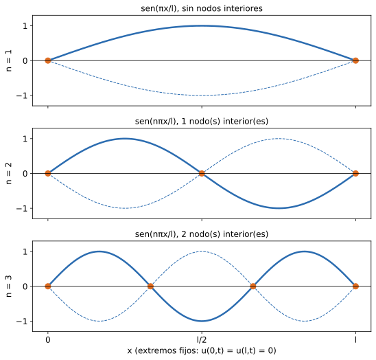

> **Alcance tentativo.** No apareció en ningún parcial práctico oficial relevado ni en el Modelo P2 teórico. Explicación elaborada para el sitio; no es material oficial. Las "p.N" son páginas del PDF. Lo marcado _hipótesis estándar_ o _apoyo no oficial_ no figura en Monllor.
>
> No hay machetes para esta unidad. Los coeficientes de Fourier que aparecen son la fórmula de la serie seno; Series de Fourier (U11) queda fuera del alcance del sitio.

## 1. Qué es una EDP y qué cambia respecto de las EDO

**Definición.** Una **ecuación diferencial en derivadas parciales** (EDP) contiene una función de **varias** variables independientes y algunas de sus derivadas parciales. Primer orden (dos variables): $f\!\left(x,y,z,\dfrac{\partial z}{\partial x},\dfrac{\partial z}{\partial y}\right)=0$; segundo orden: aparecen también $\dfrac{\partial^2z}{\partial x^2},\dfrac{\partial^2z}{\partial x\partial y},\dfrac{\partial^2z}{\partial y^2}$.

**Diferencia clave.** La solución general de una EDO tiene **constantes arbitrarias**; la de una EDP tiene **funciones arbitrarias**. Además no siempre se puede obtener la solución general. Ejemplo (Monllor p.2): $\dfrac{\partial z}{\partial x}=0$ tiene solución $z=\varphi(y)$, con $\varphi$ una función arbitraria. En la práctica se buscan soluciones que cumplan **condiciones de contorno** (en la frontera) y **condiciones iniciales** (en $t=0$). Fuente: 11-ECUACIONES DIFERENCIALES CON DERIVADAS PARCIALES 2015.pdf p.2; Recuperatorio P2 (v2).pdf p.58

## 2. Clasificación de las EDP lineales de 2º orden

**Definición (resumen de alumno, apoyo no oficial).** Para $A\,u_{xx}+B\,u_{xy}+C\,u_{yy}+G(x,y,u,u_x,u_y)=0$, según el signo de $B^2-4AC$:

| $B^2-4AC$ | Tipo | Ecuación típica | Modela |
|---|---|---|---|
| $<0$ | **Elíptica** | Laplace: $u_{xx}+u_{yy}=0$ | estado estacionario (no depende de $t$) |
| $=0$ | **Parabólica** | Calor (Fourier): $u_t=c^2u_{xx}$ | propagación de calor, difusión |
| $>0$ | **Hiperbólica** | Ondas (D'Alembert): $u_{tt}=c^2u_{xx}$ | vibraciones, ondas (cuerda) |

Monllor clasifica cada ecuación por su nombre (onda: hiperbólica, p.3; calor: parabólica, p.7; Laplace: elíptica, p.11) sin dar el discriminante: el criterio $B^2-4AC$ es del resumen de alumno (apoyo no oficial; $A$, $B$, $C$ son los coeficientes de la fórmula de arriba y $G$ el término de orden menor). Fuente: 11-ECUACIONES DIFERENCIALES CON DERIVADAS PARCIALES 2015.pdf p.3, 7, 11; Recuperatorio P2 (v2).pdf p.58-59

**Ejemplo mínimo** (en cada caso la segunda variable ocupa el lugar de $y$ en la fórmula; $A$ es el coeficiente de $u_{xx}$, $C$ el de la derivada segunda en la otra variable): $u_{xx}+u_{yy}=0$: $A=1,B=0,C=1\Rightarrow-4<0$, elíptica. $u_t-c^2u_{xx}=0$: $A=-c^2,\ B=0,\ C=0\Rightarrow0$, parabólica. $u_{tt}-c^2u_{xx}=0$: $A=-c^2$, $B=0$, $C=1$ (de $u_{tt}$) $\Rightarrow 4c^2>0$, hiperbólica _(cuentas verificadas con sympy)_.

## 3. Ecuación de ondas: cuerda vibrante (separación de variables)

**Definición.** $\dfrac{\partial^2u}{\partial t^2}=c^2\dfrac{\partial^2u}{\partial x^2}$, con $u(x,t)$ la posición transversal del punto $x$ de la cuerda en el instante $t$, y $c^2$ una constante.

**Problema (cuerda de longitud $l$, extremos fijos).**
- Condiciones de contorno: $u(0,t)=0,\ u(l,t)=0$.
- Condiciones iniciales: $u(x,0)=f(x)$ (forma inicial), $\dfrac{\partial u}{\partial t}(x,0)=\varphi(x)$ (velocidad inicial).

**Método de separación de variables (Fourier).** Se busca $u=X(x)\,T(t)$. Reemplazando: $\dfrac{T''}{c^2T}=\dfrac{X''}{X}=-\lambda^2$ (cada miembro depende de una variable distinta, así que ambos son constantes). Se obtienen dos EDO de 2º orden con coeficientes constantes (U9):

$$X''+\lambda^2X=0,\qquad T''+c^2\lambda^2T=0$$

con soluciones $X=A\cos\lambda x+B\sin\lambda x$ y $T=C\cos c\lambda t+D\sin c\lambda t$. La condición $X(0)=0$ da $A=0$; $X(l)=0$ con $B\ne0$ exige $\sin\lambda l=0$, o sea $\lambda_n=\dfrac{n\pi}{l},\ n=1,2,3,\dots$ (**valores propios**).

**Solución.** Como la ecuación es lineal y homogénea, se suman todas las soluciones:

$$u(x,t)=\sum_{n=1}^{\infty}\left(C_n\cos\frac{cn\pi}{l}t+D_n\sin\frac{cn\pi}{l}t\right)\sin\frac{n\pi}{l}x$$

y las condiciones iniciales fijan los coeficientes (serie seno de Fourier de $f$ y $\varphi$ en $[0,l]$):

$$C_n=\frac2l\int_0^l f(x)\sin\frac{n\pi x}{l}\,dx,\qquad D_n=\frac{2}{cn\pi}\int_0^l \varphi(x)\sin\frac{n\pi x}{l}\,dx$$

**Compatibilidad.** Para que haya solución continua hace falta $f(0)=f(l)=0$ (y $\varphi(0)=\varphi(l)=0$): la forma inicial y la velocidad deben respetar los extremos fijos. La serie es formal; converge a $f$ si $f$ es seccionalmente suave _(hipótesis estándar)_.

**Por qué $-\lambda^2$** _(hipótesis estándar)_. Sea $X''=KX$ con $X(0)=X(l)=0$. Si $K=0$: $X=A+Bx$ y los dos contornos dan $A=B=0$. Si $K=\mu^2>0$: $X=Ae^{\mu x}+Be^{-\mu x}$, $X(0)=0$ da $B=-A$ y $X(l)=0$ da $A=0$. En ambos casos $X\equiv0$. Solo con $K=-\lambda^2<0$ hay $X$ no trivial. Se toma **$\lambda>0$ sin pérdida de generalidad**: $\lambda$ y $-\lambda$ dan la misma solución (Monllor 11, p.14).

**Condiciones (solo si…).** Extremos fijos (si fueran otras condiciones de contorno, cambian los valores propios); $B\ne0$ porque si no $u\equiv0$ (cuerda en reposo). **Interpretación.** Cada término es un **modo normal** de vibración con frecuencia proporcional a $n$.

**Ejemplo mínimo.** Cada $u_n=\sin\frac{n\pi x}{l}\left(C\cos\frac{cn\pi t}{l}+D\sin\frac{cn\pi t}{l}\right)$ cumple $u_{tt}=c^2u_{xx}$ y los extremos fijos _(verificado con sympy)_.

**Gráfico.** Cuerda de longitud $l$ con extremos fijos, y los primeros modos normales $\sin(n\pi x/l)$ para $n=1,2,3$: media onda, una onda y una onda y media, con $n-1$ nodos interiores. Fuente: 11-ECUACIONES DIFERENCIALES CON DERIVADAS PARCIALES 2015.pdf p.3-6

## 4. Ecuación del calor en un vástago

**Definición.** $\dfrac{\partial u}{\partial t}=c^2\dfrac{\partial^2u}{\partial x^2}$ (en 2 y 3 dimensiones, $c^2\nabla^2u$). Modela un vástago homogéneo de longitud $l$ cuya superficie lateral no disipa calor y de temperatura uniforme en cada sección.

**Problema.** $u(x,0)=\varphi(x)$ (temperatura inicial) y extremos a temperatura 0: $u(0,t)=u(l,t)=0$.

**Método.** Con $u=X(x)T(t)$: $\dfrac{T'}{c^2T}=\dfrac{X''}{X}=-\lambda^2$, lo que da $X''+\lambda^2X=0$ (misma que antes, $\lambda_n=n\pi/l$) y $T'+c^2\lambda^2T=0$ (**EDO de 1er orden**, $T=Ce^{-c^2\lambda^2t}$).

**Solución.**

$$u(x,t)=\sum_{n=1}^{\infty}D_n\,e^{-\frac{c^2n^2\pi^2}{l^2}t}\,\sin\frac{n\pi}{l}x,\qquad D_n=\frac2l\int_0^l\varphi(x)\sin\frac{n\pi x}{l}\,dx$$

**Por qué $-\lambda^2$.** Igual que en la cuerda: con $X''=KX$ y $X(0)=X(l)=0$, los casos $K=0$ y $K>0$ llevan a $X\equiv0$; solo $K=-\lambda^2<0$ da $X$ no trivial, con $\lambda>0$ sin pérdida de generalidad ($\lambda$ y $-\lambda$ dan lo mismo) _(hipótesis estándar)_. Compatibilidad: $\varphi(0)=\varphi(l)=0$ (la temperatura inicial debe coincidir con la de los extremos); la serie es formal y converge a $\varphi$ si es seccionalmente suave.

**Interpretación.** Cada modo decae exponencialmente en el tiempo (los modos altos más rápido): la temperatura tiende a 0.

**Gráfico.** Perfil de temperatura $u(x,t)$ sobre el vástago en tres instantes: una forma inicial $\varphi(x)$ que se aplana hacia la recta $u=0$, con los extremos siempre en 0.

**Ejemplo mínimo.** $u_n=e^{-c^2n^2\pi^2t/l^2}\sin(n\pi x/l)$ cumple $u_t=c^2u_{xx}$ _(verificado con sympy)_. Fuente: 11-ECUACIONES DIFERENCIALES CON DERIVADAS PARCIALES 2015.pdf p.7-10

## 5. Ecuación de Laplace y problema de Dirichlet

**Definición.** $\nabla^2u=\dfrac{\partial^2u}{\partial x^2}+\dfrac{\partial^2u}{\partial y^2}\,(+\dfrac{\partial^2u}{\partial z^2})=0$. Es el **estado estacionario del calor** ($\partial u/\partial t=0$ en la ecuación del calor). Sus soluciones son las **funciones armónicas**; por ejemplo $u=x^2-y^2$ (su Laplaciano es $2-2=0$, verificado con sympy).

> **Error del apunte.** Monllor p.11 da como ejemplos de funciones armónicas $z=3y^2-4x^2$ y $z=x^2+xy$, pero $\nabla^2(3y^2-4x^2)=6-8=-2\ne0$ y $\nabla^2(x^2+xy)=2\ne0$ (verificado con sympy): tal como están escritos **no son armónicas**. Se deja asentado sin corregir el original; no usar esos ejemplos para estudiar.

**Problema de Dirichlet.** Determinar la función armónica en una región dados sus valores en la frontera. Para un **círculo** de radio $R$ con $u(R,\theta)=f(\theta)$, en polares ($r^2u_{rr}+ru_r+u_{\theta\theta}=0$), con $u=\mathcal R(r)\,\Theta(\theta)$ se llega a $\Theta''+\lambda^2\Theta=0$ y $r^2\mathcal R''+r\mathcal R'-\lambda^2\mathcal R=0$ (con solución $r^{\pm\lambda}$); pidiendo solución **periódica y acotada** en el círculo resulta $\lambda=n$ entero. Caso $\lambda=0$: $\Theta_0=A_0+B_0\theta$ y $\mathcal R_0=C_0+D_0\ln r$, es decir $u_0=(A_0+B_0\theta)(C_0+D_0\ln r)$; la periodicidad en $\theta$ exige $B_0=0$ y la acotación en $r=0$ exige $D_0=0$ (queda la constante). Para $\lambda>0$, $\mathcal R=C_\lambda r^{\lambda}+D_\lambda r^{-\lambda}$ y la acotación en $r=0$ da $D_\lambda=0$ (Monllor 11, p.13). Resulta

$$u(r,\theta)=\frac{a_0}{2}+\sum_{n=1}^{\infty}\big(a_n\cos n\theta+b_n\sin n\theta\big)\,r^n$$

donde $a_0=\dfrac1\pi\displaystyle\int_{-\pi}^{\pi}f(t)\,dt$, $a_n=\dfrac{1}{\pi R^n}\displaystyle\int_{-\pi}^{\pi}f(t)\cos nt\,dt$ y $b_n=\dfrac{1}{\pi R^n}\displaystyle\int_{-\pi}^{\pi}f(t)\sin nt\,dt$ salen de pedir $u(R,\theta)=f(\theta)$ (desarrollo de Fourier de $f$ en $[-\pi,\pi]$; Monllor p.14). Fuente: 11-ECUACIONES DIFERENCIALES CON DERIVADAS PARCIALES 2015.pdf p.11-14

**Forma normalizada.** Con $(r/R)^n$ en lugar de $r^n$ la serie es la misma con $c_n=a_nR^n$ (coeficientes de Fourier de $f$), y en $r=R$ queda la serie de Fourier de $f$.

**Gráfico.** Círculo de radio $R$ con valores $f(\theta)$ dibujados sobre la circunferencia; adentro, la función armónica $u(r,\theta)$ que los interpola (sin máximos ni mínimos interiores).

## Lo que ya tomaron

Fuentes: `../Links e Info.md` (apuntes de un compañero). U10 no tiene preguntas en el [Modelo P2 teórico](../../parciales/modelo-teorico/).

- Según las notas, **Fourier no se tomó** porque no se llegó a dar. La única mención en la lista de temas del parcial real son las **condiciones para la serie de Fourier** (condiciones de Dirichlet de acotación, número finito de discontinuidades de 1.ª especie y de extremos; la serie converge a $f$ en los puntos de continuidad y a la media de los límites laterales en los de discontinuidad), de Monllor 10 p.2-3, fuera del alcance del sitio (no confundir con el problema de Dirichlet de la sección 5).
- U10 no figura entre las unidades de los parciales relevados: alcance tentativo.
- Formato del 2º teórico: 2 temas (elegir uno y desarrollar), 4 preguntas cortas, 3 de opción múltiple. Candidatos por analogía con el preguntero: clasificación (sección 2), separación de variables para la cuerda o el calor (secciones 3 y 4), función armónica (sección 5).

**Preguntero de la unidad:** [preguntas de U10 (temas, cortas y choice)](../../preguntero/#h-U10).
